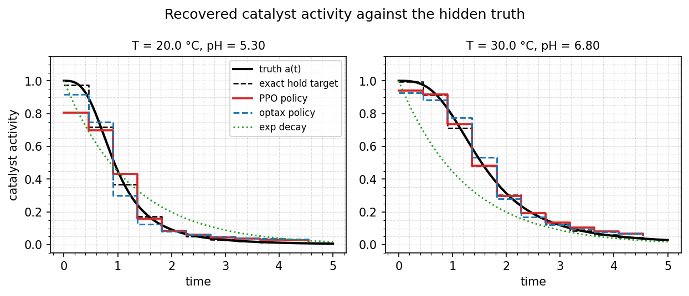
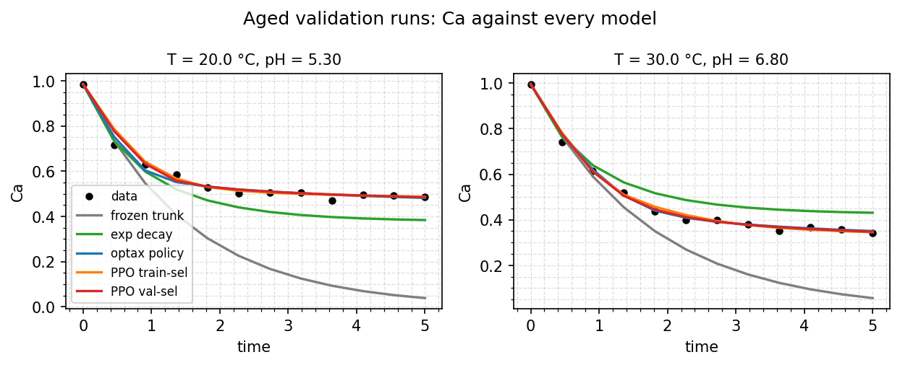
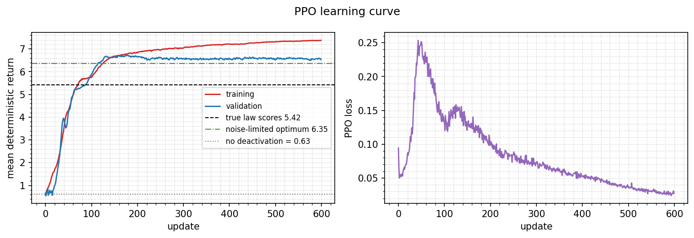

# Batch reactor RL

The [batch reactor](/examples/batch-reactor) fitted $k(T, \text{pH})$ on
fresh catalyst. Here that model is frozen and run on aged catalyst whose
activity falls during the batch. A `BoundedPredictor` policy learns the
missing activity, interval by interval, and PPO trains it without ever
differentiating the ODE solve. Read this if you want to train a predictor
with an algorithm the library does not ship, or to see how `BoundScaler`
bounds an RL action without a `tanh` squash. The framing follows Mowbray,
Wu, Rogers, Del Rio-Chanona and Zhang, [*A reinforcement learning-based
hybrid modeling framework for bioprocess kinetics
identification*](https://doi.org/10.1002/bit.28262) (2023).

## Run it

```bash
uv run python examples/batch_reactor/train_rl_deactivation.py
```

About 90 s on CPU: two Optax baselines and 600 PPO updates of 576 episodes
each. Prints reference returns, the PPO learning curve and a results table,
and writes six figures to `examples/batch_reactor/figures_rl/`.
`--updates 0` skips PPO and runs only the baselines. `rlax` comes with the
`examples` extra.

The frozen model is the committed `artefacts/trunk_fresh.eqx`. After
changing part one, rebuild it with:

```bash
uv run python examples/batch_reactor/train_hybrid.py --no-plot \
    --save-predictors examples/batch_reactor/artefacts/trunk_fresh.eqx
```

## The model

Aged catalyst multiplies the fresh rate by an activity factor:

$$
k(T, \text{pH}, t) = a(t, \text{pH})\,k_\text{fresh}(T, \text{pH}),
\qquad
a(t, \text{pH}) = \frac{1}{1 + \left(t / \tau(\text{pH})\right)^{3}}
$$

with $\tau$ shorter at low pH, so acid fouls the catalyst sooner. The cubic
gives a plateau then a sharp fall. First-order deactivation,
$a = e^{-k_d t}$, would be one extra scalar with a closed-form solution, and
a time-varying policy would have nothing to do. The fouling is severe on
purpose: the batch stalls at about 55% conversion while the fresh model
predicts it runs nearly to completion. Nine aged runs at the same
$(T, \text{pH})$ points as part one, at constant temperature, plus two
validation runs.

Kinetic parameters become control actions. Between each pair of the 12
measurements the policy reads the model's own state and emits an activity;
the model integrates that interval with the activity held fixed; the reward
is the fit at the next measurement:

$$
r_t = \exp\!\left(-\frac{(C_A^{m} - C_A^{d})^2}{\sigma^2}\right) - w\,\operatorname{saturation}(z_t)
$$

$\sigma^2$ is the `ChannelObs.variance` the dataset already carries. The
return is undiscounted, since it is a fit criterion over a finite horizon.
The rollout is free-running: the policy sees the state its own earlier
actions produced, not the measurement, so the trained policy is a model you
can run forward on a new batch.

Activity is held constant across each interval, and that loses nothing.
For $\mathrm{d}C_A/\mathrm{d}t = -k\,a(t)\,C_A$ only $\int a$ over an
interval enters the solution, so holding $a$ at its interval mean
reproduces the continuous truth exactly. The step function the policy
emits is an exact target, not an approximation of $a(t_i)$.

## Code

The policy is an ordinary `BoundedPredictor` on `(Ca, temperature_C, pH)`.
The covariates are in the observation because only $C_A$ is measured and
$C_{A,0}$ is fixed, so a policy on conversion alone would give a hot acidic
batch and a cool neutral one the same action:

```python
return BoundedPredictor(
    input_keys=OBS_KEYS,
    in_scaler=BoundScaler(bounds=OBS_BOUNDS, transform="sigmoid"),
    inner=MLPPredictor(
        in_size=len(OBS_KEYS),
        out_size=1,
        width_size=POLICY_WIDTH,
        depth=POLICY_DEPTH,
        activation_name="tanh",
        key=key,
    ),
    out_scaler=BoundScaler(bounds=ACTIVITY_BOUNDS, transform="sigmoid"),
)
```

PPO splits it at `out_scaler`. The input scaler and inner network give the
Gaussian mean over a latent $z$; the sampled $z$ is the action; and
`out_scaler.from_latent(z)` maps it into the activity box inside the
rollout, as part of the dynamics:

```python
mean = _policy_mean(agent, obs)
noise = jnp.where(deterministic, 0.0, jr.normal(sub, mean.shape))
z = mean + std * noise
log_prob = _gaussian_log_prob(z, mean, agent.log_std)
activity = agent.policy.out_scaler.from_latent(z)[0]
```

Three things follow from sampling in the latent space:

- The log-probability is a plain diagonal Gaussian. Nothing was squashed
  inside the distribution, so there is no log-det-Jacobian correction.
- The bound is structural. No finite $z$ maps outside the box, so nothing
  is clipped.
- `BoundScaler.saturation(z)` reads the latent and goes into the reward.
  A penalty on the physical activity would die where it is needed, because
  `from_latent`'s derivative underflows exactly where the squash saturates.

Recombined, the two halves are exactly `BoundedPredictor.__call__`, so the
trained policy goes straight into `predict_dataset` and `compute_metrics`.
`tests/test_example_batch_reactor_rl.py` pins that identity.

The activity box is $(0, 1.05)$, not $(0, 1)$. Fresh catalyst has activity
exactly 1, and a sigmoid only approaches its edge, so a ceiling of 1 would
force the policy to saturate at $t = 0$ and set the penalty against the fit.

PPO differentiates the policy's log-probability and the value head. The
rollout produces rewards and is never differentiated, so
`SolverConfig.adjoint` plays no part and the solver could be stiff,
nonsmooth or a black box. That is the reason to use RL on a problem whose
gradient is well behaved, and it is the argument the [Evosax
trainer](/guide/training) makes by another route.

## Results

Default settings, seed 0.

| model | train $R^2$ | val $R^2$ | val RMSE | gap |
|---|---|---|---|---|
| frozen trunk, no deactivation | -0.662 | -1.139 | 0.254 | +0.477 |
| trunk + fitted exponential decay | 0.840 | 0.830 | 0.072 | +0.010 |
| trunk + policy, Optax through the solve | 0.993 | 0.991 | 0.017 | +0.002 |
| trunk + policy, PPO, train-selected | 0.994 | 0.987 | 0.020 | +0.007 |
| trunk + policy, PPO, validation-selected | 0.993 | 0.989 | 0.018 | +0.004 |

`gap` is train $R^2$ minus validation $R^2$. The frozen model is worse than
predicting the mean, because it runs each batch nearly to completion after
fouling has stalled it. One decay scalar recovers most of the damage but
cannot bend twice. Both learned policies reach $R^2 \approx 0.99$. The
gradient-trained policy edges out PPO, as expected on a problem this
smooth; PPO gets there without touching the adjoint.





### Reading the return

The return is not out of 11. With residuals $\varepsilon \sim
\mathcal{N}(0, \sigma^2)$, $\mathbb{E}[e^{-\varepsilon^2/\sigma^2}] =
1/\sqrt{3}$, so a model that fits only the signal scores about
$11/\sqrt{3} = 6.35$.

The true law scores less than that, 5.42 on the training runs and 5.23 on
validation. Every model, the truth included, starts its free-running
rollout from the noisy first observation, and that offset costs the truth
about 0.6 to 1.0 of return. Started from the exact initial state it scores
6.06 and 6.19. A policy reads $C_A$ and can steer back, so scoring above the
true law is not by itself a sign of overfitting. Scoring above 6.35 is.



Training return keeps climbing to 7.37, 1.16 times the noise-limited
optimum. Eleven free actions per run against twelve noisy measurements
leave room to fit the noise, and the policy uses it. Validation return
peaks at 6.73 around update 177, within noise of 6.35 on two runs, then
settles near 6.55. Selecting on training return, the only signal an RL loop
has without held-out data, picks the overfitted iterate, so `train_ppo`
returns both agents and the table reports both.

### Why rlax and PPO

`rlax` supplies `truncated_generalized_advantage_estimation` and
`clipped_surrogate_pg_loss` as plain array functions, with no network
framework and no environment API. That keeps the actor an equinox
`BoundedPredictor` and the environment a `lax.scan` of `diffeqsolve` calls.
`rlax.entropy_loss` is categorical, so the Gaussian entropy is computed in
closed form from `log_std`. The agent is partitioned into arrays and static
parts before the PPO scans, because `MLPPredictor` holds its activation as
a callable and a `lax.scan` carry must be arrays.

PPO rather than the paper's SAC: the MDP is deterministic, the horizon is
11 steps and rollouts are nearly free, so off-policy replay buys little for
about twice the code.

## Things to try

- `--updates 0` for the baselines alone.
- `--penalty-weight 0`, then compare `05_latent_saturation.png`, which
  shows where the sampled latents sit against the squash knee.
- Raise `TAU_REF` in the script. Slower fouling brings the frozen model
  closer to the data and leaves less for a policy to learn.
