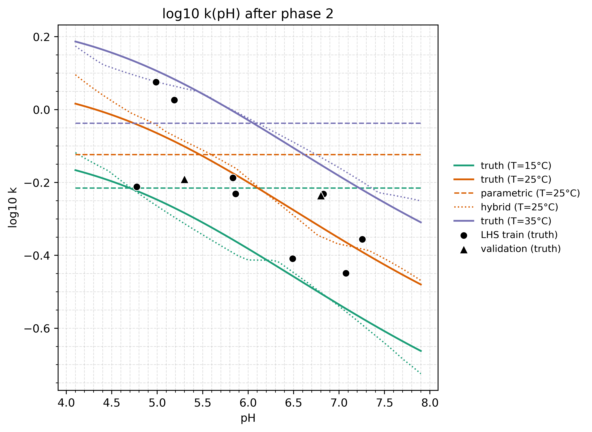
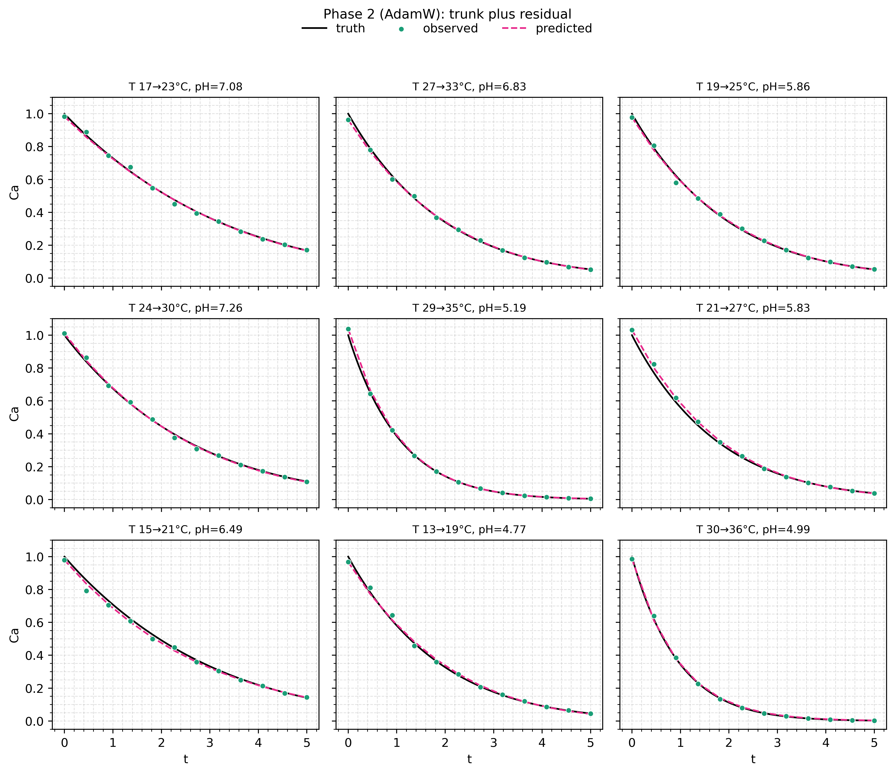

# Batch reactor

A first-order reaction $A \to B$ whose rate constant depends on
temperature through Arrhenius, which we know, and on pH through a curve
with no first-principles form, which we do not. Fitting Arrhenius
separately at each pH gives one set of constants per pH and no way to
predict between them. The hybrid model keeps the Arrhenius trunk and adds
a small bounded residual network, so one model covers every pH and
interpolates. It is fitted in two phases: CMA-ES for the trunk, then
gradients for the residual.

```bash
uv run python examples/batch_reactor/train_hybrid.py
```

## The model

The rate is split log-additively into a pH-blind trunk and a residual:

$$
\log_{10} k(T, \text{pH}) = \log_{10} k_\text{param}(T) + \Delta\log_{10} k(T, \text{pH})
$$

The trunk is centred Arrhenius with two bounded scalars,
$\log k_\text{ref}$ and $E_a$. The residual is a 16-neuron MLP inside a
`BoundedPredictor` whose output box is $[-2, 2]$ decades. The box is
symmetric, so a freshly initialised network outputs about zero and the
hybrid starts out equal to the trunk. Both live in `_model.py`, which the
[RL example](/examples/batch-reactor-rl) also imports.

Each run heats along a flat-ramp-flat profile. The ramp parameters are
covariates, and `simulate_fn` turns them into $T(t)$ with `ramp_profile`
inside the vector field, so one run sweeps a band of temperatures.

## Two phases on one model

Both phases call `HybridModel.fit` on the same model. A `trainable` mask
picks which half of the predictor tuple moves:

```python
model = HybridModel(
    predictors=build_predictors(key=k_init),  # (ArrheniusKinetics, BoundedPredictor)
    simulate_fn=simulate_fn,
    state_to_output=state_to_output,
    output_channel_names=("Ca",),
    solver=solver,
)

# Phase 1: CMA-ES on the trunk. The residual is frozen.
mask_p1 = freeze_modules_of_type(
    trainable_mask(model.predictors), model.predictors, BoundedPredictor
)
fit_p1 = model.fit(train_dataset, config_p1, key=k_p1, trainable=mask_p1)

# Phase 2: AdamW on the residual. The trunk is frozen.
mask_p2 = freeze_modules_of_type(
    trainable_mask(fit_p1.model.predictors), fit_p1.model.predictors, ArrheniusKinetics
)
fit_p2 = fit_p1.model.fit(train_dataset, config_p2, key=k_p2, trainable=mask_p2)
```

`config_p1` is an `EvosaxTrainingConfig` (CMA-ES, 60 generations,
`init="lhs_box"`) and `config_p2` an `OptaxTrainingConfig` (800 steps).
`fit` returns a `FitResult`; the script reads
`fit_p1.history.best_fitness` and `fit_p2.history.loss` for the combined
loss curve. Because the residual starts at zero, phase 2's first loss
equals phase 1's last.

The script checks each step as it goes: that phase 1 trains exactly two
scalars, that the frozen half is bit-identical after each phase, and that
phase 2 at least halves the loss.

## Results

Default settings, seed 0. The parametric trunk cannot see pH, so its
curves are flat; the hybrid follows the truth across the pH range:





The validation points (triangles) at `(20 °C, 5.3)` and `(30 °C, 6.8)`
were never fitted.

## Other scripts in the folder

- `notebook.py` is a longer walkthrough with constant temperature per run
  and three pH bins. It fits the per-pH Arrhenius baseline, shows it
  failing to transfer between bins, and scores the hybrid with
  leave-one-out and leave-one-pH-out cross-validation. It runs about 40
  fits.
- `presentation_plots.py` draws slide figures comparing per-bin,
  joint, linear-in-pH and hybrid fits on a harder truth whose activation
  energy varies with pH.

`--save-predictors PATH` writes the phase-2 predictors for [part two, the
RL example](/examples/batch-reactor-rl), which freezes this fitted model
and learns a catalyst-activity policy on top of it.
