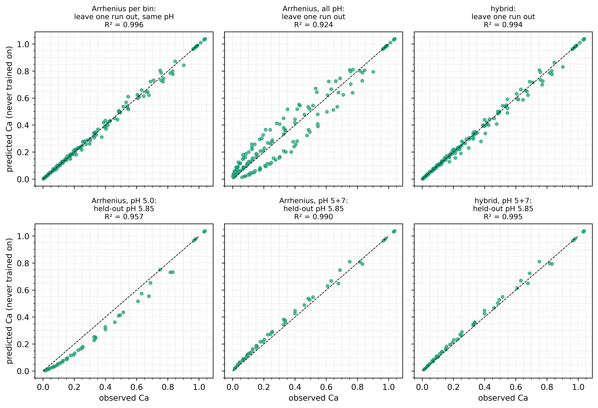
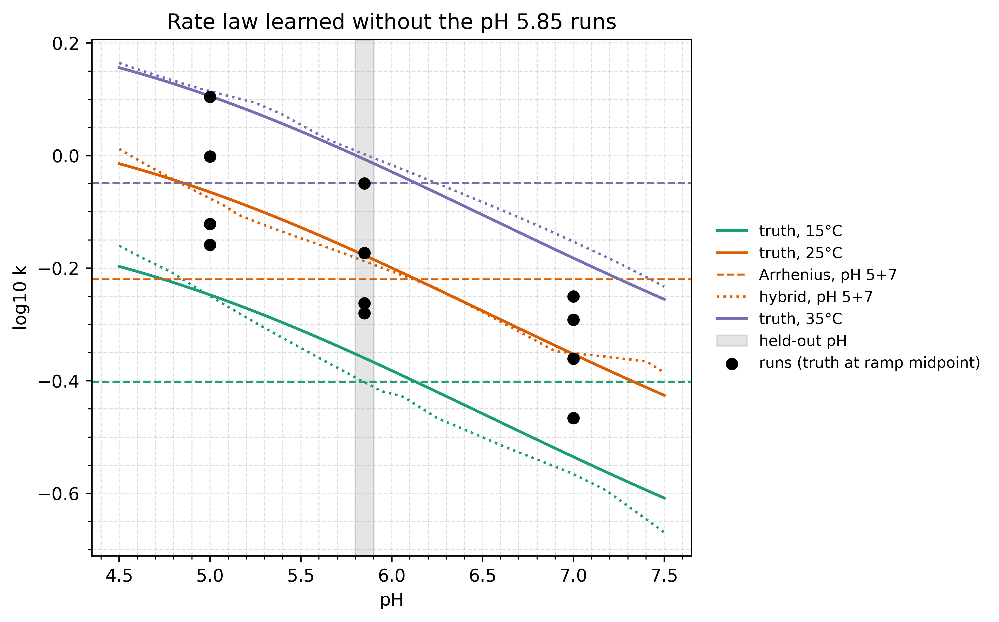

# Batch reactor

A first-order reaction $A \to B$ whose rate depends on temperature through
Arrhenius, which is known, and on pH through a curve with no
first-principles form. The hybrid model keeps a two-scalar Arrhenius trunk
and adds a small bounded residual network, fitted in two phases on one
`HybridModel`: CMA-ES for the trunk, then AdamW for the residual. A second
script compares it with the classical alternative, one Arrhenius fit per
pH, on runs neither model trained on. Read this for staged training with
`fit(freeze=...)`, or for a worked case of when a residual network earns
its place. The [RL example](/examples/batch-reactor-rl) continues from the
fitted model.

## Run it

```bash
uv run python examples/batch_reactor/train_hybrid.py
uv run python examples/batch_reactor/compare_baselines.py
```

`train_hybrid.py` takes about 20 s and writes seven figures to
`examples/batch_reactor/figures/`. `compare_baselines.py` runs 54 fits in
about two minutes and writes three more. Both accept `--no-plot`, and
`--generations` / `--steps` for a short run. `train_hybrid.py
--save-predictors PATH` writes the fitted predictors for the RL example.

## The model

$$
\frac{\mathrm{d}C_A}{\mathrm{d}t} = -k\,C_A,
\qquad
\log_{10} k(T, \text{pH}) = \log_{10} k_\text{param}(T) + \Delta\log_{10} k(T, \text{pH})
$$

The trunk is Arrhenius centred at 25 °C, with two bounded scalars:

$$
k_\text{param}(T) = \exp\!\left(\log k_\text{ref} - \frac{E_a}{R}\left(\frac{1}{T} - \frac{1}{T_\text{ref}}\right)\right)
$$

The residual is a 16-neuron MLP inside a `BoundedPredictor` whose output box
is $[-2, 2]$ decades. The box is symmetric, so a fresh network outputs about
zero and the hybrid starts out equal to the trunk. Both live in `_model.py`.

The hidden truth is Arrhenius with $E_a = 30$ kJ/mol times a Hill-type
saturation in pH: fast below pH 5, a plateau above 7, a knee at 5.85. Each
run heats along a flat-ramp-flat profile of $\pm 3$ °C around its midpoint.
The four ramp parameters are covariates, and `simulate_fn` turns them into
$T(t)$ with `ramp_profile` inside the vector field. Only $C_A$ is measured,
12 times per run, with 3% noise. Truth and data generation are in
`_data.py`.

## Code

Both phases call `fit` on the same model:

<<< @/../examples/batch_reactor/train_hybrid.py#model

Phase 1 passes `freeze=hm.BoundedPredictor`, which holds the residual
fixed and leaves the trunk's two scalars, and fits them with CMA-ES (32
candidates, 60 generations by default):

<<< @/../examples/batch_reactor/train_hybrid.py#phase-1

Phase 2 freezes the trunk's class instead and refines the residual with
AdamW (800 steps by default):

<<< @/../examples/batch_reactor/train_hybrid.py#phase-2

The script asserts that phase 1 trains exactly two scalars and that the
frozen half is bit-identical after each phase.

`compare_baselines.py` builds the classical baseline from the same
predictor tuple. `simulate_trunk_fn` integrates the trunk alone and ignores
the residual, so the same `freeze` choices work on both models:

<<< @/../examples/batch_reactor/compare_baselines.py#models

## Results

### Two-phase fit

Nine training runs on a Latin hypercube in $(T, \text{pH})$, two validation
runs off the design. Seed 0.

| model | train $R^2$ | validation $R^2$ |
|---|---|---|
| trunk only, after CMA-ES | 0.959 | 0.962 |
| hybrid, after AdamW | 0.9985 | 0.9973 |

The pH-blind trunk settles on $E_a = 15$ kJ/mol against a true 30. With
nine runs, temperature and pH are partly correlated in the design, so a
trunk that cannot see pH trades some of the pH effect into the temperature
slope. The residual takes both inputs and corrects both: the dotted hybrid
curves follow the truth at all three temperatures, while the dashed trunk
is flat in pH by construction.


### Against per-pH Arrhenius fits

`compare_baselines.py` uses a different design, chosen so the classical
method can be fitted at all: four ramp runs at each of pH 5.0, 5.85 and
7.0. Fitted bin by bin, Arrhenius recovers $E_a$ within 3.5 kJ/mol of the
truth in each bin and absorbs pH into $\log k_\text{ref}$. Every score below
is on runs the model never trained on.

| model | test | $R^2$ |
|---|---|---|
| Arrhenius, one fit per pH | leave one run out, same pH | 0.996 |
| Arrhenius, one fit across all pH | leave one run out | 0.924 |
| hybrid | leave one run out | 0.994 |
| Arrhenius, pH 5.0 fit | held-out pH 5.85 | 0.957 |
| Arrhenius, one fit on pH 5.0 and 7.0 | held-out pH 5.85 | 0.990 |
| hybrid, trained on pH 5.0 and 7.0 | held-out pH 5.85 | 0.995 |

Per-pH fits are as good as the hybrid inside their own bin and give no model
for any other pH. A single Arrhenius fit across all pH loses the most,
because one prefactor has to stand in for a rate that changes by a factor of
two across the bins. The hybrid matches the per-bin fits with one model.

On the held-out pH the margin is smaller. Borrowing the nearest bin's fit
is clearly worse. A joint Arrhenius fit on the two outer bins lands close,
because pH 5.85 sits near the midpoint of their rates and averaging the two
happens to be about right there. The hybrid is still the best of the three,
and the rate law it learned without pH 5.85 bridges the gap:





## Things to try

- `--doe-seed` on `train_hybrid.py` draws a different design. Watch the
  trunk's $E_a$ move with how correlated $T$ and pH happen to be.
- `--generations 5 --steps 20` on either script for a quick check.
- Move `HELD_OUT_BIN` in `compare_baselines.py` to an edge bin. Neither
  model was built to extrapolate in pH.
