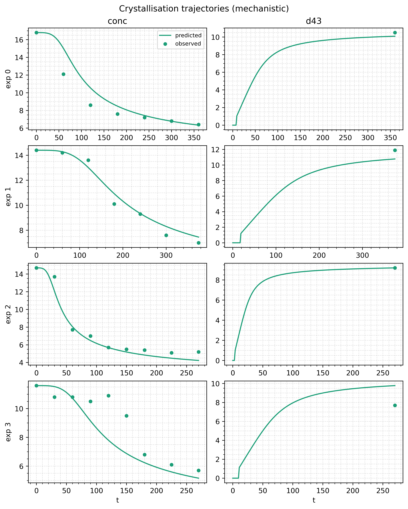

# Crystallisation (mechanistic)

The parametric baseline for the [hybrid crystallisation
example](/examples/crystallisation). Same data, moment ODE and observation
model; the two rate networks are replaced by closed-form kinetics with
four fitted constants, searched with CMA-ES. Use it as a template for
fitting a handful of bounded physical constants without gradients, and as
the number a hybrid model has to beat.

## Run it

```bash
uv run python examples/crystallisation/train_crystallisation_mechanistic.py
uv run python examples/crystallisation/train_crystallisation_mechanistic.py \
    --generations 2 --population-size 8 --no-plot   # smoke check
```

The default runs 80 generations of 64 candidates, under a minute on CPU.
It prints the four constants before and after the fit and per-channel
metrics, and writes `parity_mechanistic.png` and
`trajectories_mechanistic.png` to `examples/crystallisation/figures/`.

## The model

The dataset, the moment equations and `state_to_output` are imported from
`train_kinetic.py`; the [hybrid page](/examples/crystallisation#the-model)
describes them. Only the rate laws differ. Nucleation follows classical
nucleation theory (CNT) and growth a power law in $S - 1$:

$$
J = e^{\log A}\, S\, \exp\!\left( -\frac{16\pi\, \gamma^3\, v^2}{3 (k_B T)^3 \ln^2 S} \right)
\qquad
G = \frac{10^{A_g}}{60}\, \max(S - 1,\ 0)^{g}
$$

| name    | meaning                               | bounds        |
|---------|---------------------------------------|---------------|
| `logA`  | $\ln A$, CNT pre-exponential factor   | (20.0, 65.0)  |
| `gamma` | interfacial energy [mJ/m²]            | (0.15, 1.0)   |
| `Ag`    | $\log_{10}$ growth pre-factor [m/min] | (-20.0, -5.0) |
| `g`     | growth exponent                       | (1.0, 3.5)    |

The bounds come from the thesis package, so the fitted values are
comparable with its runs. All four constants are shared by every
experiment; temperature enters only through CNT and the solubility.

## Code

Each constant is a `Parameter` that starts at the midpoint of its bounds:

<<< @/../examples/crystallisation/train_crystallisation_mechanistic.py#model

A `Parameter` stores an unbounded latent and returns its bounded physical
value from `.value`. CMA-ES searches the latents, so every candidate maps
inside the box and the search needs no constraint handling. The constants
are read once per solve, outside the vector field:

<<< @/../examples/crystallisation/train_crystallisation_mechanistic.py#vector-field

Passing an `EvosaxTrainingConfig` to `fit` selects the evolutionary
trainer:

<<< @/../examples/crystallisation/train_crystallisation_mechanistic.py#config

`init="lhs_box"` fills generation 0 with a Latin hypercube over the latent
box, and each generation is one compiled, vmapped evaluation of the whole
population. CNT makes the ODE stiff for many candidates, so this script
uses the implicit `Kvaerno3` solver. `result.history.best_fitness` holds
the best loss so far at each generation.

## Results

Seed 0, 80 generations of 64:

| constant | init   | fitted |
|----------|-------:|-------:|
| `logA`   | 42.50  | 26.03  |
| `gamma`  | 0.575  | 0.444  |
| `Ag`     | -12.50 | -9.14  |
| `g`      | 2.250  | 3.198  |

Against the hybrid model on the same data, from the default run of
`train_kinetic.py`:

| model                     | trained                  | best loss | conc $R^2$ | d43 $R^2$ |
|---------------------------|--------------------------|----------:|-----------:|----------:|
| hybrid, two MLPs          | 600 Adam steps           | 0.274     | 0.970      | 0.983     |
| mechanistic, 4 constants  | 80 × 64 CMA-ES           | 1.230     | 0.884      | 0.404     |



The mechanistic fit gets the shape of each concentration curve but not
the timing. Its rates depend only on temperature and supersaturation,
with four constants shared by every experiment, so the two 17 °C runs
differ only in their starting concentration (14.7 and 11.6). One drops
within an hour, the other stays flat for about 150 minutes. CNT and a
power law cannot produce that much difference from that change in $S$,
so the fit misses the delayed run's timing and overshoots its terminal
`d43`. The hybrid rates face the same constraint but have a free shape in
$S$, which is enough to fit both runs. Neither model can say why
the replicates differ; a hybrid that fits them better is not evidence of
a better mechanism.

## Things to try

- `--init uniform_box` or `--init warm` to compare generation-0 strategies.
- `--population-size 16` to see how much a smaller population costs.
- Fix `g` at 2 by replacing its `Parameter` with `hm.Constant(2.0)`, and
  fit three constants instead of four.
