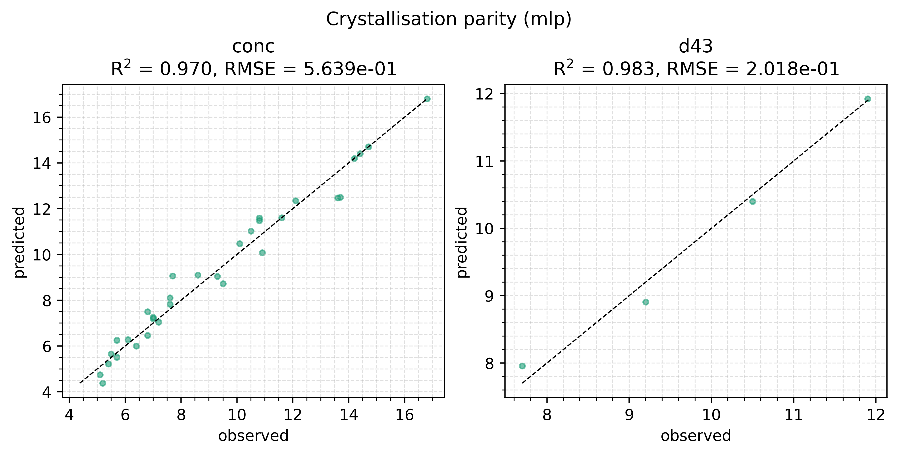
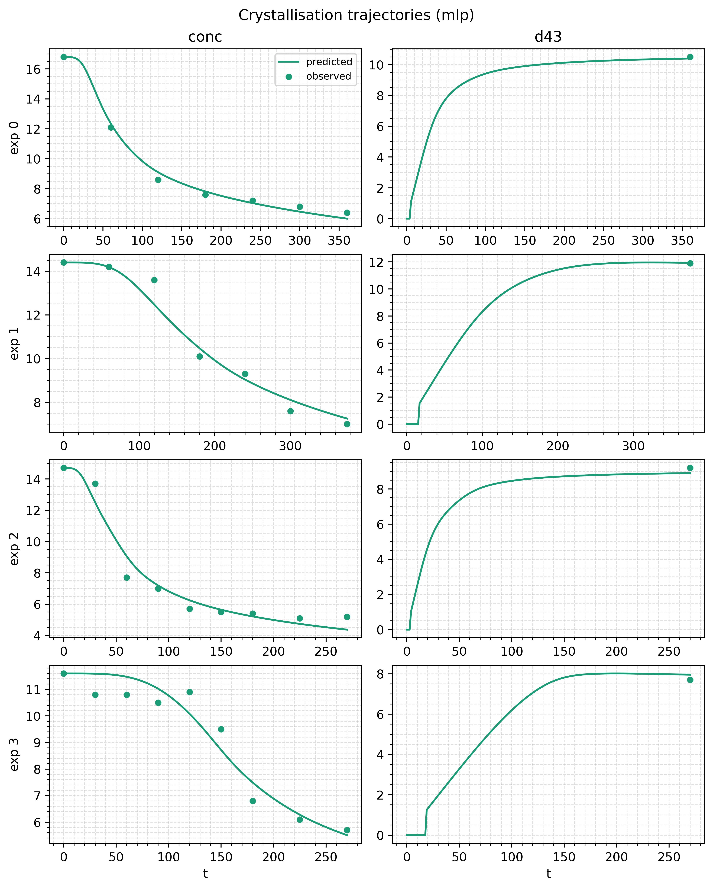

# Crystallisation (hybrid MLP)

The canonical end-to-end example: a hybrid kinetic model fitted to four
crystallisation experiments, each an irregular concentration trajectory
with one particle-size measurement at the end. Two neural networks emit
the unknown rate laws, and those rates drive a population-balance ODE.

**Crystallisation** is a dissolved solute leaving solution as solid
crystals, driven by **nucleation**, new crystals appearing, and
**growth**, existing ones getting larger. Nobody can derive either rate
from first principles for a given system, which is the situation this
library is for.

The script is `examples/crystallisation/train_kinetic.py`. The four
experiments are written into it, so it needs no data file.

```bash
uv run python examples/crystallisation/train_kinetic.py           # 600 steps per family
uv run python examples/crystallisation/train_kinetic.py --steps 50 --no-plot   # quick check
```

## What we're modelling

A six-state population balance:

$$
\begin{aligned}
\frac{d\mu_0}{dt} &= J(t) \\
\frac{d\mu_k}{dt} &= k\, G(t)\, \mu_{k-1}, \quad k = 1, 2, 3, 4 \\
\frac{d\,\text{conc}}{dt} &= -3\, K_v\, \rho_c\, G(t)\, \mu_2
\end{aligned}
$$

The $\mu_k$ are **moments** of the crystal size distribution: $\mu_0$
counts crystals, $\mu_3$ tracks total volume, and $\mu_4 / \mu_3$ gives a
mean diameter. Tracking five moments instead of the full distribution
turns a partial differential equation into six ordinary ones.

$G$ (growth velocity, m/s) and $J$ (nucleation rate, per m³ per second)
are the unknowns. Rather than commit to Classical Nucleation Theory or a
power law, two networks learn $\log_{10} G$ and $\log_{10} J$ from
`(temperature_C, supersaturation)`, and the vector field exponentiates
back to physical rates inside the integrator. **Supersaturation** is
concentration over saturation concentration; above 1 the solution is
loaded and crystals can form.

Two quantities are observed: concentration (measured often) and the
volume-weighted mean diameter $d_{43} = \mu_4 / \mu_3 \cdot 10^6$ µm
(one measurement per experiment, at the end).

For a parametric counterpart that fits four scalars instead of two
networks, see [Crystallisation (mechanistic)](/examples/crystallisation-mechanistic).

## The dataset

Four experiments reproduced from the thesis `Unseeded_LowData4` cut,
rounded to 1 dp on values and 3 dp on variance. Concentration variance
is one made-up scalar (`CONC_VAR = 0.1`) broadcast across every row. The
$d_{43}$ variances are the rounded thesis values.

| `exp_id`      | T (°C) | n conc | n d43 | t span (min) | terminal d43 (µm) |
|---------------|-------:|-------:|------:|--------------|------------------:|
| `LowData4_3`  | 17.0   | 9      | 1     | 0 → 270      | 9.2               |
| `LowData4_4`  | 17.0   | 9      | 1     | 0 → 270      | 7.7               |
| `LowData4_7`  | 21.0   | 7      | 1     | 0 → 360      | 10.5              |
| `LowData4_9`  | 21.0   | 7      | 1     | 0 → 375      | 11.9              |

Two experiments at each of two temperatures, on different time grids.
`make_dataset` merges each experiment's per-channel timestamps into one
axis and groups experiments by that axis's length. The terminal `d43` time
is already on each concentration grid, so the 21 °C pair forms a bucket of
length 7 and the 17 °C pair a bucket of length 9. Each bucket compiles
once.

## Experiments

An **experiment** is one run. A **channel** is one measured quantity with
its own timestamps. A **covariate** is a condition fixed for the whole
run; here, temperature.

```python
def y0_fn(covariates, channels):
    """Initial state [mu0..mu4, conc]: no crystals, conc at its first observation."""
    init_conc = jnp.asarray(channels["conc"].values[0])
    return jnp.concatenate([jnp.zeros(5, dtype=init_conc.dtype), init_conc[None]])


hm.make_experiment(
    covariates={"temperature_C": data["temperature_C"]},
    channels={
        "conc": hm.ChannelObs(ts=time_min, values=conc, variance=jnp.full_like(conc, CONC_VAR)),
        "d43": hm.ChannelObs(  # one terminal measurement
            ts=jnp.asarray([data["d43_time_min"]]),
            values=jnp.asarray([data["d43"]]),
            variance=jnp.asarray([data["d43_var"]]),
        ),
    },
    y0_fn=y0_fn,
    exp_id=data["exp_id"],
)
```

`y0_fn` builds the full initial state once per experiment, when the
experiment is made. The moments start at zero because the suspension is
clear at `t = 0`; concentration starts at its first observation.

## Observation model

The solver returns six states and two are observed. `state_to_output`
selects concentration and derives $d_{43}$ from two moments:

```python
def state_to_output(state):
    mu3, mu4, conc = state[..., 3], state[..., 4], state[..., 5]
    safe_mu3 = jnp.where(mu3 > D43_MU3_EPS, mu3, 1.0)
    ratio = jnp.where(mu3 > D43_MU3_EPS, (mu4 / safe_mu3) * 1e6, 0.0)
    d43 = jnp.clip(jnp.where(jnp.isfinite(ratio) & (ratio > 0.0), ratio, 0.0), 0.0, D43_MAX)
    return jnp.stack([conc, d43], axis=-1)
```

The `safe_mu3` line keeps the gradient finite. Guarding only the result
still divides by zero on the discarded branch, and that `nan` gradient
flows back through `where`. See
[Recommendations](/guide/recommendations#guard-the-divisor-not-the-result).

## Rate predictors

Each rate is a `BoundedPredictor` that reads both inputs by name and
returns a log10 rate inside its bounds:

```python
INPUT_KEYS = ("temperature_C", "supersaturation")
TEMPERATURE_BOUNDS = (13.0, 27.0)       # °C
SUPERSATURATION_BOUNDS = (0.0, 12.0)    # S = conc / conc_sat
LOG10_GROWTH_BOUNDS = (-15.0, -5.0)     # log10(G [m/s])
LOG10_NUCLEATION_BOUNDS = (-6.5, 20.0)  # log10(J [#/(m³·s)])

input_bounds = (TEMPERATURE_BOUNDS, SUPERSATURATION_BOUNDS)
predictors = {
    "growth": hm.BoundedPredictor(
        inner=mlp(k_growth),
        input_keys=INPUT_KEYS,
        input_bounds=input_bounds,
        output_bounds=LOG10_GROWTH_BOUNDS,
    ),
    "nucleation": hm.BoundedPredictor(
        inner=mlp(k_nucleation),
        input_keys=INPUT_KEYS,
        input_bounds=input_bounds,
        output_bounds=LOG10_NUCLEATION_BOUNDS,
    ),
}
```

where `mlp(key)` is an `MLPPredictor(in_size=2, out_size=1,
width_size=64, depth=1, activation_name="relu", key=key)`. The KAN run
swaps in `KANPredictor(in_size=2, out_size=1, hidden_widths=(64,), ...)`
and changes nothing else.

The output bounds matter more than anything else here. An untrained
network outputs roughly the midpoint of its box, so that midpoint is the
rate the solver sees on the first step. `(-15, -5)` puts growth at
$10^{-10}$ m/s, reasonable for early growth. An earlier `(-12, -3)` put
it at $3 \cdot 10^{-8}$ m/s, and the random-init rates were too stiff
for the solver to finish within `max_steps`. See
[Recommendations](/guide/recommendations#bounds).

The KAN inner networks call `.with_zero_final_head()`, which zeroes the
readout layer so the initial output is exactly the midpoint. Without it
jaxkan's init starts nucleation decades below the midpoint, the moments
never move, and the loss stays flat. `MLPPredictor` has the same method;
the MLP run does not need it on the default seed.

## Vector field

`simulate_fn` is where the physics goes. Its signature is fixed and its
body is yours:

```python
def simulate_fn(predictors, ts, covariates, y0, solver):
    temperature_C = covariates["temperature_C"]
    conc_sat = saturation_conc(temperature_C)

    def vector_field(t, y, args):
        S = y[5] / conc_sat
        meta_mask = (S > 1.0 + META_EPS).astype(y.dtype)
        inputs = {"temperature_C": temperature_C, "supersaturation": S}
        G = meta_mask * 10.0 ** predictors["growth"](inputs)[0]
        J = meta_mask * 10.0 ** predictors["nucleation"](inputs)[0]
        return moment_rhs(y, G, J)

    return integrate_minutes(vector_field, ts, y0, solver)
```

Temperature is a covariate and supersaturation comes from the state, but
the predictors read both as named inputs. The metastable mask turns both
rates off once the solution is no longer supersaturated.

The script defines three helpers that the
[mechanistic example](/examples/crystallisation-mechanistic) reuses:

- `saturation_conc(T)` is an empirical solubility polynomial.
- `moment_rhs(y, G, J)` returns the six derivatives in the equations at
  the top of this page.
- `integrate_minutes(vector_field, ts, y0, solver)` integrates in seconds
  while the data are in minutes. With `dt0=None` it picks the first step
  from each experiment's span.

Most examples call `solver.diffeqsolve(term, ts, y0)`. `integrate_minutes`
calls diffrax directly because of the time conversion, and still takes
the step controller and adjoint from the `SolverConfig`, so the per-state
`atol` and the configured adjoint apply.

## Solver, model and training

The moments span about 18 decades, so `atol` has one entry per state:

```python
SOLVER = hm.SolverConfig(
    solver=diffrax.Tsit5(),
    rtol=1e-4,
    atol=(1e3, 1e-2, 1e-6, 1e-10, 1e-14, 1e-5),
    max_steps=500_000,
    dt0=None,
)

model = hm.HybridModel(
    predictors=predictors,
    simulate_fn=simulate_fn,
    state_to_output=state_to_output,
    output_channel_names=("conc", "d43"),
    solver=SOLVER,
)
result = model.fit(dataset, hm.OptaxTrainingConfig(steps=600, lr=1e-3), key=k_train)
```

`result.model` is the fitted model. The first step pays for compilation,
once per bucket.

## Reading the result

```python
predictions = result.model.predict(dataset)
hm.print_metrics(hm.compute_metrics(predictions.buckets, dataset))

reference = {"temperature_C": 17.0, "supersaturation": 1.5}
log10_G = hm.evaluate_predictor(result.model.predictors["growth"], reference)
```

The learned rate laws can be read at any condition inside their bounds,
including ones no experiment visited. The script prints the rates at
17 °C and `S = 1.5` before and after training, then writes parity and
trajectory plots under `examples/crystallisation/figures/`.

Seed 0, 600 steps, MLP family:





The concentration parity sits close to the identity line, and the
terminal `d43` points land within their variance of the fitted curves.
The KAN family reaches a similar concentration fit but a worse terminal
`d43`. The [hybrid ODE](/examples/hybrid-ode#results) and [custom
predictor](/examples/custom-predictor#results) examples show the same
pattern.
