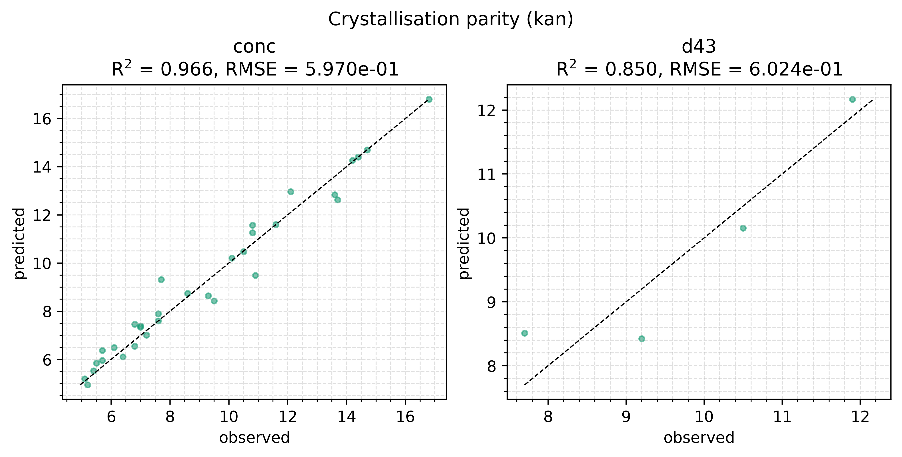

# Crystallisation (hybrid)

Two neural networks learn the growth and nucleation rates of a batch
crystallisation, inside a known population-balance ODE, from four
experiments with irregular sampling. This is the fullest example of the
main workflow: named covariates and state-derived inputs, bounded
log-rates, a stiff multi-scale ODE, and two observed channels measured at
different times. Read the [harmonic oscillator](/examples/pendulum) first
if `HybridModel` is new to you.

## Run it

```bash
uv run python examples/crystallisation/train_kinetic.py
uv run python examples/crystallisation/train_kinetic.py --steps 20 --no-plot   # smoke check
```

The default fits the model twice, with MLPs and with KANs, 600 steps
each, in about two minutes on CPU. It prints the rates at a reference
condition before and after training and per-channel metrics, and writes
`parity.png` and `trajectories.png` to `examples/crystallisation/figures/{mlp,kan}/`.
The four experiments are written into the script, so no data file is
needed.

## The model

Crystallisation is a dissolved solute leaving solution as solid crystals.
It is driven by **nucleation**, new crystals appearing, and **growth**,
existing crystals getting larger. Neither rate can be derived from first
principles for a given system.

The crystal size distribution is tracked by its first five **moments**,
$\mu_k(t) = \int L^k\, n(L, t)\, dL$, plus the solute concentration. This
turns the population balance, a partial differential equation in size and
time, into six ODEs:

$$
\begin{aligned}
\frac{d\mu_0}{dt} &= J \\
\frac{d\mu_k}{dt} &= k\, G\, \mu_{k-1}, \quad k = 1, \dots, 4 \\
\frac{d\,\text{conc}}{dt} &= -3\, K_v\, \rho_c\, G\, \mu_2
\end{aligned}
$$

$\mu_0$ counts crystals and $\mu_3$ is proportional to their volume. The
moment equations and the mass balance are known. The growth velocity $G$
(m/s) and nucleation rate $J$ (crystals per m³ per s) are learned: two
networks map temperature and supersaturation $S = \text{conc} /
\text{conc}_\text{sat}(T)$ to $\log_{10} G$ and $\log_{10} J$. Both rates
are zero unless $S > 1$.

Two quantities are observed: concentration, sampled through each run, and
the volume-weighted mean diameter $d_{43} = 10^6\, \mu_4 / \mu_3$ µm,
measured once at the end.

| `exp_id`     | T (°C) | conc points | t span (min) | terminal d43 (µm) |
|--------------|-------:|------------:|--------------|------------------:|
| `LowData4_3` | 17     | 9           | 0 to 270     | 9.2               |
| `LowData4_4` | 17     | 9           | 0 to 270     | 7.7               |
| `LowData4_7` | 21     | 7           | 0 to 360     | 10.5              |
| `LowData4_9` | 21     | 7           | 0 to 375     | 11.9              |

The values are rounded from the `Unseeded_LowData4` sheet of the thesis
workbook in `examples/crystallisation/data/`. They are typed into the
script rather than read with `hm.experiments_from_dataframe`, since the
results below were produced from the rounded values. Each experiment is
built with `hm.experiment_from_array` from a `[conc, d43]` table whose
`d43` column is NaN except at the final sample. The
experiments do not share a time grid, so `make_dataset` groups them into
two buckets by merged grid length, 9 for the 17 °C pair and 7 for the
21 °C pair. Each bucket compiles once.

For a fit of four closed-form kinetic constants to the same data, see
[Crystallisation (mechanistic)](/examples/crystallisation-mechanistic).

## Code

Each rate is a `BoundedPredictor` that reads both inputs by name and
returns a log10 rate inside its output bounds:

<<< @/../examples/crystallisation/train_kinetic.py#predictors

The output bounds set the starting point. An untrained network outputs
roughly the midpoint of its box, so `LOG10_GROWTH_BOUNDS = (-15.0, -5.0)`
starts growth near $10^{-10}$ m/s, a plausible early rate. A wider box
starts decades higher and makes the ODE too stiff to integrate from the
first step. The KAN family also calls `.with_zero_final_head()`, which
puts its first output exactly at the midpoint; jaxkan's default init lands
decades below it and the loss never moves.

Temperature is a covariate and supersaturation comes from the state, but
the networks read both the same way:

<<< @/../examples/crystallisation/train_kinetic.py#simulate-fn

`integrate_minutes` calls diffrax directly rather than
`solver.diffeqsolve`, because the data are in minutes and the rates per
second. It still takes the step controller and adjoint from the
`SolverConfig`, and returns the diffrax `Solution`, whose `ys` the library
reads as the state. The moments span about 18 decades, so the config gives
one `atol` per state:

<<< @/../examples/crystallisation/train_kinetic.py#solver

`state_to_output` maps the six states to `[conc, d43]`. Its division
replaces $\mu_3$ by a safe value before dividing, because guarding only
the result still evaluates $\mu_4 / 0$ on the discarded branch and that
`nan` reaches the gradient (see
[Recommendations](/guide/recommendations#guard-the-divisor-not-the-result)):

<<< @/../examples/crystallisation/train_kinetic.py#safe-division

Fitting and reading the learned rates:

<<< @/../examples/crystallisation/train_kinetic.py#fit

<<< @/../examples/crystallisation/train_kinetic.py#read-rates

`evaluate_predictor` reads a learned rate at any condition inside its
input bounds, including conditions no experiment visited.

## Results

Seed 0, 600 Adam steps per family:

| family | best loss | conc $R^2$ | d43 $R^2$ |
|--------|----------:|-----------:|----------:|
| MLP    | 0.274     | 0.970      | 0.983     |
| KAN    | 0.336     | 0.967      | 0.850     |

Both families fit concentration about equally well. The KAN family is
worse on the terminal `d43`, which has one point per experiment and so
little say in the loss. At 17 °C and $S = 1.5$ the MLP learns
$G = 1.0 \times 10^{-11}$ m/s and $J = 1.6 \times 10^{11}$ per m³ per s.


The KAN parity, for comparison:



The [mechanistic page](/examples/crystallisation-mechanistic#results)
compares these numbers with four fitted CNT and power-law constants.

## Things to try

- `--kan-basis base` drops the KAN splines, as an ablation.
- `--kan-grid-size 10` gives each KAN edge a finer spline.
- `--steps 2000` to see whether the KAN `d43` fit catches up.
- Widen `LOG10_GROWTH_BOUNDS` to `(-12, -3)` and watch the first solve hit
  `max_steps`.
