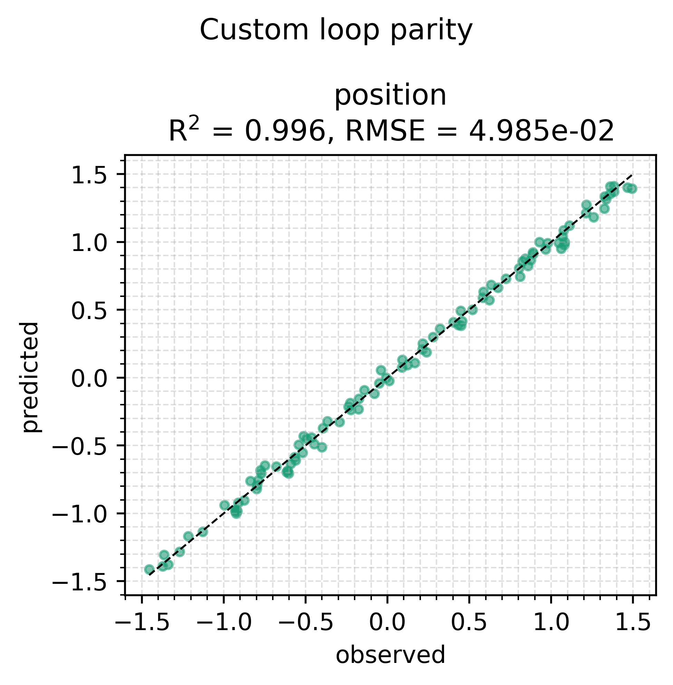

# Custom training loop

`train_with_optax` is assembled from public pieces in
[`jaxhybridmodels.training.kernels`](/api/kernels). When you need a loop it
cannot express, such as a different accumulation rule, per-bucket weights,
or your own regulariser, compose the same pieces instead of forking the
trainer.

```bash
uv run python examples/custom_loop/train_custom_loop.py
```

The script recovers a harmonic oscillator's frequency $\omega$ from noisy
positions, the same problem as the [harmonic oscillator](/examples/pendulum)
example. It uses three kernels:

| Kernel | Returns | Called |
| --- | --- | --- |
| [`build_bucket_step`](/api/kernels#build_bucket_step) | jitted `(predictors, bp, horizon) -> (loss, grads)` | once per bucket per step |
| [`build_penalty_step`](/api/kernels#build_penalty_step) | `(predictors, weight, points) -> (penalty, weighted_grads)` | once per step |
| [`build_apply_update`](/api/kernels#build_apply_update) | `(predictors, grads, opt_state) -> (predictors, opt_state)` | once per step |

The custom part is the accumulation: each bucket's loss and gradients are
weighted by its experiment count, so the three-experiment bucket counts
three times the one-experiment bucket. The stock trainer has no option for
that. The loop also passes a masked Huber loss as `loss_fn` and an L2 term
on a second `Parameter`, `scale`, as `penalty_fn`. `OptaxTrainingConfig`
accepts both of those too (`loss=` and `penalty_fn=`); they are here to
show where each hook enters a hand-written loop.

Both unknowns are [`Parameter`](/api/predictors#parameter) values in a
dict, so the loop reads them with `predictors["omega"].value`.

## The script

<<< ../../examples/custom_loop/train_custom_loop.py

## Results

Seed 0, 150 steps:

```
recovered omega = 1.0020  (truth 1.0)
final scale     = 0.070060  (regularised toward 0)
```



The parity RMSE is 0.050, the noise standard deviation, so the fit has
reached the noise floor.
