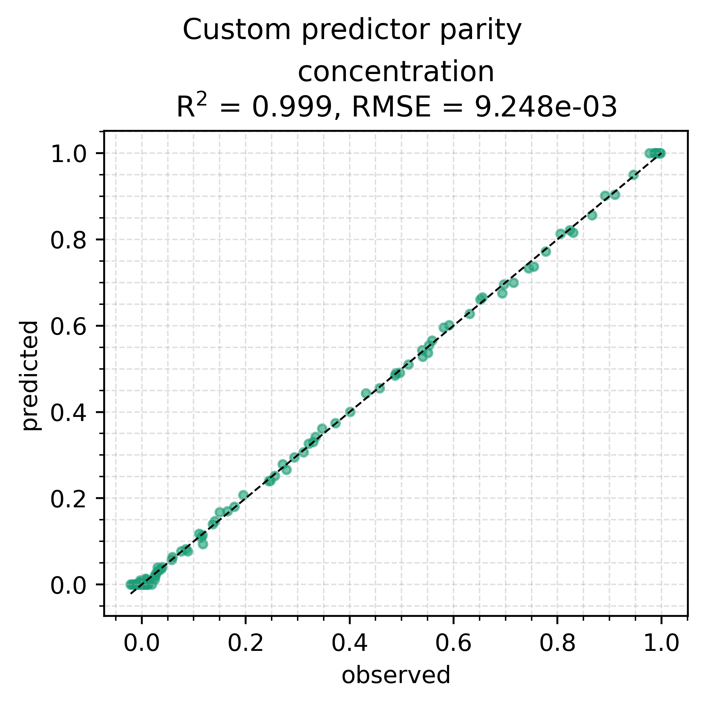
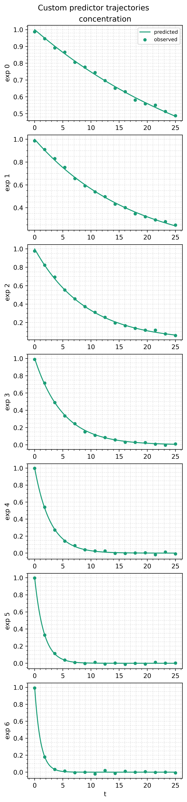

# Custom predictor

The library ships an MLP, a KAN and a neural polynomial, but a predictor is
only a trainable module mapping an array to an array. This example writes a
fourth family from scratch, random Fourier features, and trains it inside a
hybrid ODE. Read it before writing your own; the procedure is written up in
[Custom predictors](/guide/custom-predictors).

## Run it

```bash
uv run python examples/custom_predictor/train_custom_predictor.py
```

About a minute on CPU. Prints the learned rate against the truth before and
after training, the save/load drift and metrics; writes `parity.png` and
`trajectories.png` to `examples/custom_predictor/figures/`. `--steps 5
--no-plot` is a quick smoke run.

## The model

First-order decay whose rate depends on temperature:

$$
\frac{dy}{dt} = -k(T)\, y, \qquad k(T) = A \exp\!\left(-\frac{E_a}{R T}\right)
$$

Each experiment is one isothermal run: a temperature between 290 and
350 K, 15 noisy points, and $y_0 = 1$. All runs share a time grid, so the
dataset is one fully observed bucket. The Arrhenius form is the answer, not
an input: the predictor sees a temperature and must produce a rate. The
true rates span 1.5 decades, so the output scaler uses a `log10` warp.

Random Fourier features project the input through a fixed random bank of
cosines and fit linear weights on top:

$$
\phi(x) = \sqrt{\tfrac{2}{m}} \cos(x\,\Omega + b), \qquad f(x) = \phi(x)\,W + c
$$

The bank $(\Omega, b)$ is drawn once and never updated; only the readout
$(W, c)$ learns. That split between fixed and trained arrays is why this
architecture was chosen. It forces every question the predictor contract
asks:

- **Which fields are static.** `in_size`, `out_size`, `n_features` and
  `bandwidth` are `eqx.field(static=True)`. The optimiser never sees them
  and `save_predictors` does not write them, so the load site has to be
  able to rebuild them. `bandwidth` is the standard deviation of the
  frequency draw; because `BoundScaler` hands the inner predictor a latent
  input of roughly unit scale, a value near 1 is the sane start.
- **How it re-initialises.** The restart
  [tournament](/guide/training#the-tournament) calls
  `initialized_with_key`. Without it, every float array is resampled from a
  standard normal: the phases stop being uniform on $[0, 2\pi)$, the
  readout loses its $1/\sqrt{m}$ scale and `bandwidth` is ignored.
- **How the bank is held fixed.** A module cannot declare its own field
  untrainable. Trainability is a mask over the pytree, set by the caller:
  here `fit(freeze=...)` with the bank's paths, which raises on a path
  that matches nothing.
- **How it round-trips.** `load_predictors` needs a template with the same
  class, container and static fields, built here by the same
  `build_predictors` used for training.

Bounds stay outside: `RandomFourierPredictor` has no bound, covariate name
or unit. `BoundedPredictor` supplies all three. The rate is constant along
a trajectory, so `simulate_fn` calls the predictor once, above the solve,
and the network never touches the solver tape. See [embedded and parallel
predictors](/guide/concepts#embedded-and-parallel-predictors) for the case
where it cannot.

## Code

The predictor subclasses `hm.Predictor`. Its class body declares the
trainable arrays, the fixed feature bank and the static shape metadata,
then implements `__call__` and the restart hook:

<<< @/../examples/custom_predictor/train_custom_predictor.py#predictor

Wrapping it with bounds:

<<< @/../examples/custom_predictor/train_custom_predictor.py#bounds

The bank is frozen by path. The paths read from the root of the predictors
dict, and `fit` takes them through `freeze=`:

<<< @/../examples/custom_predictor/train_custom_predictor.py#bank-paths

<<< @/../examples/custom_predictor/train_custom_predictor.py#mask

The fit runs a three-restart tournament, which is what exercises
`initialized_with_key`:

<<< @/../examples/custom_predictor/train_custom_predictor.py#fit

## Results

Default settings, seed 0, 400 steps after the tournament. "Worst rate
error" is the largest relative error in $k(T)$ across the seven sampled
temperatures. The save and reload changes the learned rate by `0.000e+00`.

| run | final data loss | $R^2$ | worst rate error |
|---|---|---|---|
| default: 64 features, bandwidth 1, bank frozen | 8.55e-05 | 0.9992 | 3.92% |
| `--n-features 16` | 8.63e-05 | 0.9992 | 4.25% |
| `--train-bank` | 8.46e-05 | 0.9993 | 3.34% |
| `--bandwidth 8` | 8.44e-05 | 0.9993 | 3.35% |

Every row fits the trajectories to the noise floor (noise variance
$10^{-4}$), and the rate law comes back within about 4%. The differences
between rows are within what a different seed would move. Below 330 K
every run is within about 1%; the error sits at 340 and 350 K, where the
decay is over in a few samples and the data says little about the rate.





The bottom panels are the hot runs: the concentration reaches zero within
three or four samples, which is why the rate law is least constrained
there.

## Things to try

- `--train-bank` trains the bank too, turning the model into an ordinary
  cosine-activation network.
- `--n-features 16` is enough for this smooth target; 64 leaves room for a
  harder rate law.
- `--bandwidth 8` resolves shorter length scales and overfits sparse data
  sooner.
