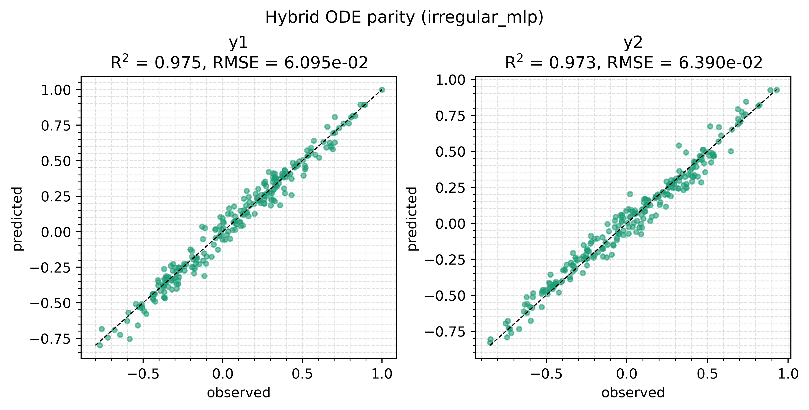
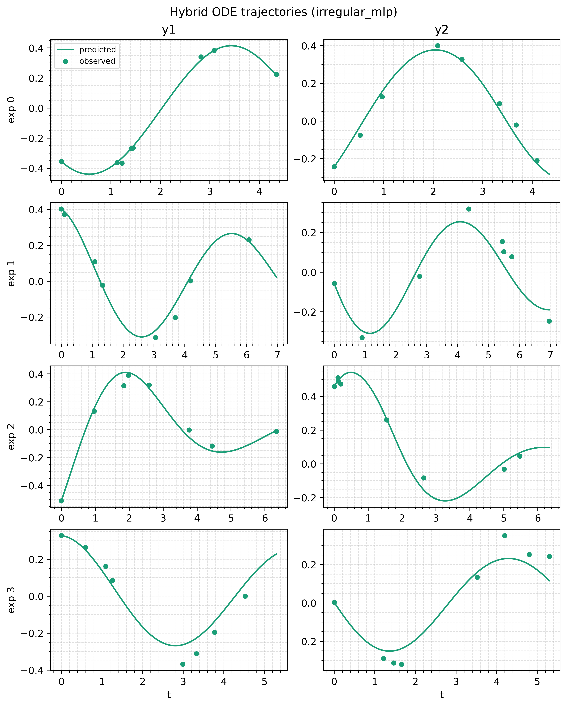

# Hybrid ODE: keep the physics, learn the gaps

A mechanistic model with two missing pieces, each filled by a bounded network: one above the solver and one inside the vector field. Read this after the [harmonic oscillator](/examples/pendulum) if you want to see where a network can sit, how bounds and warps behave, and why a residual protects the parameters you care about.

## Run it

```bash
uv run python examples/hybrid_ode/train_hybrid_ode.py
```

About a minute on CPU. Prints the bucket layout, the losses, the saturation penalty per network, the recovered rate law and residual error, and per-channel metrics. Writes `parity_irregular_mlp.png` and `trajectories_irregular_mlp.png` to `examples/hybrid_ode/figures/` unless you pass `--no-plot`.

## The model

The data comes from a rotation at frequency $\omega$, damped at rate $k$, with a cubic coupling:

$$
\frac{dy}{dt} =
\begin{bmatrix} -k & \omega \\ -\omega & -k \end{bmatrix} y + C y^{3},
\qquad \omega = 1
$$

The model keeps the rotation and knows $\omega$. It does not know two things. $k$ depends on each experiment's temperature through an Arrhenius law, from 0.0063 to 0.276 across the six temperature levels, a factor of 44. $C y^3$ is missing from the model entirely. Both are synthesised so the fit can be checked against them.

### Where each network sits

| | learns | called | on the solver tape |
|---|---|---|---|
| `rate` | $T \mapsto k$ | once per experiment | no |
| `residual` | $y \mapsto$ correction | once per solver step | yes |

A covariate is constant along a trajectory, so anything that depends only on covariates is computed before the solve and closed over as a constant. Its cost does not grow with the step count and it never appears on the tape the backward pass walks. A term that depends on the state has to run inside. A trainable network inside a vector field is a neural ODE, which [diffrax](https://docs.kidger.site/diffrax/) and [Equinox](https://docs.kidger.site/equinox/) document.

The library is never told which network is where. Both are ordinary calls inside `simulate_fn`.

### Bounds, warps and squashes

`rate` has an output box of $(10^{-3}, 1)$. Under a linear axis the box midpoint is 0.5, so every rate in the data sits in the bottom 3% of the range, reachable only through large negative latents. A **warp** reparameterises the axis before normalising: under `log10` the midpoint is 0.032 and the data covers the middle of the box. Which values are reachable does not change.

The residual's box straddles zero, so `log10` is unusable, and a linear axis spends resolution on large corrections that should never happen. The script registers a signed-logarithmic warp, `symlog`, that is linear near zero and logarithmic in the tails. `forward(0) = 0`, so a fresh residual starts near no correction.

The squash decides how fast gradient dies at a bound. The derivative of `from_latent` carries a factor $\sigma'(z/T)$, which for a sigmoid in float32 underflows to zero near $|z/T| = 17$. The residual visits the edge of its box early in training, so it uses `softsign`, whose gradient decays polynomially:

| name | tail of $\lvert du/dz \rvert$ | dead at |
|---|---|---|
| `sigmoid` | $e^{-\lvert z \rvert}$ | $z \approx 17$ |
| `algebraic` | $\lvert z \rvert^{-3}/2$ | $z \approx 3 \times 10^{3}$ |
| `softsign` | $\lvert z \rvert^{-2}/2$ | $z \approx 10^{7}$ |

Polynomial decay makes recovery slow rather than impossible: escaping from $z = 100$ under a $c/z^2$ gradient takes $10^6$ times as long as from $z = 1$.

### Two data layouts

`--data irregular` (the default) gives each experiment its own end time in $[6, 9]$ and draws each channel's sample times separately, 8 or 12 per channel. The union length is `n1 + n2 - 1` (the shared $t = 0$ counts once), so three lengths and three buckets appear:

```
3 bucket(s)
  bucket 0: N= 5 experiments, T= 15 timestamps, D=2 channels, mask 0.53 full
  bucket 1: N=11 experiments, T= 19 timestamps, D=2 channels, mask 0.53 full
  bucket 2: N= 8 experiments, T= 23 timestamps, D=2 channels, mask 0.52 full
```

`--data rectangular` puts every experiment on one 20-point grid with both channels measured every time: one bucket, full mask. The model code is identical for both. Training compiles once per bucket, and nothing is padded to a common length or dropped.

## Code

`simulate_fn` shows both placements. The rate network runs once and its output becomes a constant; the residual runs inside `vector_field`:

<<< @/../examples/hybrid_ode/train_hybrid_ode.py#simulate-fn

The two networks, with their warps and squashes:

<<< @/../examples/hybrid_ode/train_hybrid_ode.py#symlog-warp

<<< @/../examples/hybrid_ode/train_hybrid_ode.py#predictors

A scaler stores its warp by name, which keeps a saved model to a small JSON sidecar plus an array file. A custom warp therefore has to be registered before a model that uses it can be loaded. [`register_bound_transform`](/api/transforms) does the same for squashes.

The solver uses a checkpointing adjoint. `DirectAdjoint`, the default, stores the whole forward trajectory, and with a network in the vector field that is usually the memory bottleneck:

<<< @/../examples/hybrid_ode/train_hybrid_ode.py#solver

Training fits the first 40% of each trajectory, then all of it, with the saturation penalty in both phases:

<<< @/../examples/hybrid_ode/train_hybrid_ode.py#fit

The saturation penalty is charged on the latent, not the physical output: a penalty on the physical value would carry the same $\sigma'(z/T)$ factor and die exactly where saturation is worst. By default it is evaluated at the measured input points. The residual reads the ODE state, which the dataset cannot resolve to measured points, so both networks get a `box_grid` sweep over their declared input box instead. `penalty_points` holds one array per network in pytree order, which for a dict means sorted keys.

## Results

Default settings, one CPU, seeds fixed.

| run | $R^2$ (y1) | $R^2$ (y2) | worst $k$ error | residual RMS |
|---|---|---|---|---|
| hybrid, irregular (3 buckets) | 0.975 | 0.973 | 1.90x | 48% |
| hybrid, rectangular (1 bucket) | 0.978 | 0.974 | 2.00x | 40% |
| `--mechanistic-only`, irregular | 0.662 | 0.701 | **33.5x** | n/a |
| `--inner kan`, irregular | 0.990 | 0.992 | 6.61x | 38% |

The default run's rate law against the Arrhenius truth it never saw:

| temperature (K) | true $k$ | fitted $k$ | ratio |
|---|---|---|---|
| 280 | 0.00629 | 0.01195 | 1.90 |
| 292 | 0.01516 | 0.02576 | 1.70 |
| 304 | 0.03412 | 0.04719 | 1.38 |
| 316 | 0.07221 | 0.08344 | 1.16 |
| 328 | 0.14463 | 0.15206 | 1.05 |
| 340 | 0.27583 | 0.31368 | 1.14 |

From trajectories alone, 1.6 decades of temperature dependence come back within a factor of two. The coldest point is worst: that trajectory barely decays inside the observation window, so $k$ is least identifiable there.

The `--mechanistic-only` row is the argument for hybrid models, and the $R^2$ column is not what makes it. Without the residual, the rate network is the only flexible part left, so it absorbs the missing cubic term into $k$, and the recovered rate at 280 K goes from 1.90 times the truth to 33.5 times. An unmodelled term does not stay in its own residual. It contaminates whichever parameter can absorb it, usually the one the experiment was built to measure.

The KAN row is the same effect the other way. A more expressive residual fits the trajectories better and recovers $k$ worse, because it absorbs part of the damping too. If a fitted parameter is what you want, use the least expressive residual that closes the gap.

Both data layouts reach the same trajectory accuracy, so a half-empty mask is not a handicap. Their rate laws differ at the cold end because the irregular end times reach 9 and the rectangular grid stops at 8.

The residual RMS is measured on a grid over the data range against a true RMS of 0.249. The grid includes corners no trajectory visited, where the residual is not identifiable, so the number overstates the error the trajectory fit sees.

The end-of-run saturation penalty per network:

```
  end-of-run saturation penalty, by network:
    rate      1.3467e+00
    residual  1.8072e-02
```

The grid covers each network's whole declared box, including inputs no experiment reached (`rate` is declared over 270 to 350 K and the data spans 280 to 340 K). A non-zero value says a network is pressed against an output bound somewhere in that box, which the training loss cannot see. The loss history can rise at the phase boundary, because the second phase sees the whole trajectory; the penalty is not part of that history, so runs with different penalty weights stay comparable.





## Things to try

- `--mechanistic-only` drops the residual and shows the parameter contamination above.
- `--inner kan` swaps both inner networks for KANs.
- `--data rectangular` trains the same model on one full bucket.
- `--penalty-weight 0` switches the saturation penalty off.
- `--steps` and `--experiments` change the budget and the dataset size.
