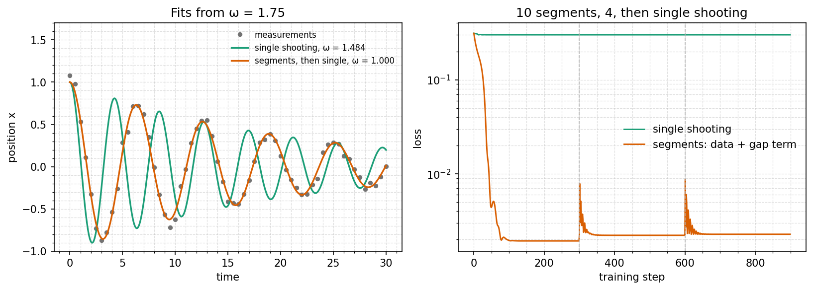

# Multiple shooting

A fit can fail because the optimiser can't see where to go, even when the
model is right. Here a damped oscillator's frequency is fitted from a poor
guess. Single shooting settles on the wrong answer. Splitting the
trajectory into segments finds the right one, and the schedule ends in
single shooting, so the returned model is an ordinary one.

Read the [multiple shooting section](/guide/training#multiple-shooting) of
the training guide for the settings.

## Run it

```bash
uv run python examples/multiple_shooting/oscillator.py
uv run python examples/multiple_shooting/oscillator.py --no-plot
```

About 40 seconds on CPU. It prints the fitted frequency from three starts
and the segmented run's summary, and writes `multiple_shooting.png` to
`examples/multiple_shooting/figures/`.

## The model

$$
x'' = -\omega^2 x - c\,x', \qquad c = 0.1 \text{ (known)}
$$

The state is $(x, v)$, and only the position $x$ is measured: 61 samples
over about 4.8 cycles, with noise of standard deviation 0.05. The truth is
$\omega = 1$.

<<< @/../examples/multiple_shooting/oscillator.py#model

## Why single shooting fails

From $\omega = 1.75$ the model completes about eight cycles while the data
completes about five. Within a cycle or two the two waves are out of step.
After that, the loss measures how two out-of-step waves happen to overlap,
not how far $\omega$ is from the truth. It is a high plateau with small dips,
and gradient descent stops in the nearest one.

## Segments, then single shooting

Each schedule runs 900 steps:

<<< @/../examples/multiple_shooting/oscillator.py#configs

Ten segments of seven samples each, sharing one sample with the next, span 3
time units: half a cycle at the true frequency, and 0.84 of one at the
starting guess of 1.75. That is how long a wrong frequency has to go wrong
before the next segment starts afresh from its own node. Four segments
follow, then single shooting:

```text
Fitted frequency (truth 1.0), 900 steps each:
  start    single  segmented
   0.40    1.0000     1.0000
   1.75    1.4840     1.0000
   1.95    1.4841     1.0000
```

The summary's phase table shows the gap term, the cost of the joins not
meeting, at the end of each segmented phase:

```text
Phases
  phase  steps    first loss     last loss  last gap term
      0    300    3.1133e-01    1.7887e-03     1.4489e-04
      1    300    2.2790e-03    2.1804e-03     3.9050e-05
      2    300    2.2786e-03    2.2767e-03              -
```

The loss spikes briefly at steps 300 and 600, where the optimiser restarts
for the new segment count.



## When it is not enough

Segments have to be short compared with how fast the model moves at its
starting guess, well under a cycle each here. On these data, ten segments
also recover $\omega$ from starts of 2.4 and 2.8. With fewer, longer
segments a fast enough starting guess falls out of step within one segment,
just as single shooting does over the whole horizon. If a segmented fit
lands in the wrong place, use more segments in the first phase.

Some models never need segments. With the damping also fitted, single
shooting reaches $\omega = 1$ here from every start. The optimiser raises
the damping first, which flattens the oscillation, then finds the frequency.
