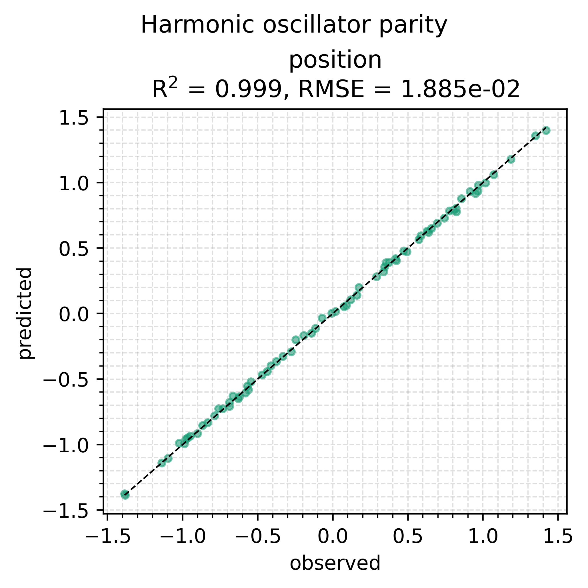
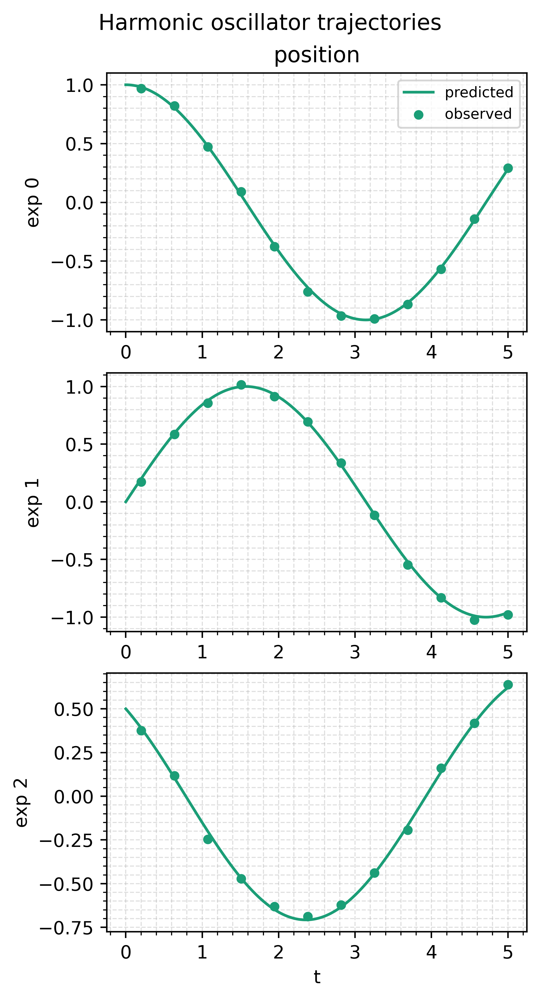

# Harmonic oscillator

The quickstart. One unknown with a known answer, the angular frequency
$\omega$ of a harmonic oscillator, run through the whole `HybridModel`
workflow: build a dataset, fit, read the result, predict, simulate new
conditions. Read it first, and come back to it when you want to check that
your own data, ODE and training path are wired correctly.

## Run it

```bash
uv run python examples/pendulum/train_harmonic.py
uv run python examples/pendulum/train_harmonic.py --no-plot
```

About 15 s on CPU. The data is generated on every run. Writes
`figures/parity.png` and `figures/trajectories.png` next to the script
unless `--no-plot` is given.

## The model

$$
\frac{dx}{dt} = v, \qquad \frac{dv}{dt} = -\omega^2 x - c\, v
$$

$\omega$ is learned, with true value 1, starting from 1.4. The damping $c$
is known to be zero and stays fixed. Six oscillators start from different
$(x_0, v_0)$ at $t = 0$. Only position is measured, at twelve points from
$t = 0.2$ to $5$, with Gaussian noise of standard deviation 0.02. Five
time units is about 0.8 of a period, enough to pin $\omega$ without a
second minimum at a multiple of it.

## Code

The model is one ODE solve, so the script writes only the vector field.
The predictors arrive as the dict given to the model, and both kinds of
value are read through `.value`. `state_to_output` keeps the measured
column:

<<< @/../examples/pendulum/train_harmonic.py#model-functions

Each experiment gives its initial state at `t0`, before the first
measurement. Use `y0_fn=` instead of `y0=` when the state has to be
computed from covariates or from the first observation:

<<< @/../examples/pendulum/train_harmonic.py#experiment

[`HybridModel.from_vector_field`](/api/model#hybridmodel) wraps the vector
field into a `simulate_fn` that integrates one experiment and returns the
full state. Write `simulate_fn` yourself when a model needs more than one
plain solve, as the [hybrid ODE](/examples/hybrid-ode) does.
`SolverConfig()` defaults to Tsit5 with `rtol=1e-5` and `atol=1e-7`; only
the first step size is set here. A [`Parameter`](/api/predictors#parameter)
trains on an unbounded latent and maps it into its bounds, so $\omega$
stays inside $(0.5, 2)$ at every step without clipping. A
[`Constant`](/api/predictors#constant) is never trained:

<<< @/../examples/pendulum/train_harmonic.py#model

Training runs two phases, a fast one to get close and a slower one to
settle. `fit` returns a [`FitResult`](/api/model#fitresult);
`result.model` is a new model with the fitted values and `model` is
unchanged:

<<< @/../examples/pendulum/train_harmonic.py#fit

`predict` runs the fitted model on each experiment's times and is indexed
by experiment, then channel. Its `times` start at `t0`, where nothing was
measured. `simulate` needs no dataset, only times, an initial state and
any covariates the model reads:

<<< @/../examples/pendulum/train_harmonic.py#predict-simulate

## Results

```
[fit]
omega 1.4 -> 0.9997 (true 1.0)
best step 186, stop reason budget_exhausted

  channel           n           MSE          RMSE           MAE      R^2
  position         72    3.5542e-04    1.8853e-02    1.5612e-02   0.9993
```

The MSE sits at the noise variance, $0.02^2 = 4 \times 10^{-4}$, so the
fit has reached the noise floor. `best_step` is the step whose parameters
were returned, and `budget_exhausted` means training ran all its steps
without stopping early.





## Things to try

- Make the damping trainable, `hm.Parameter(0.1, bounds=(0.0, 1.0))`, and
  start $\omega$ from 1.9. With two unknowns and a far start, the same 300
  steps reach $\omega \approx 1.03$ instead of 1.000, and `best_step` is
  the last step: the run needs more steps, not a different model.
- If $\omega$ comes out more than about 1% from 1.0 after you adapt this
  script, look first at `state_to_output` and the initial states.
