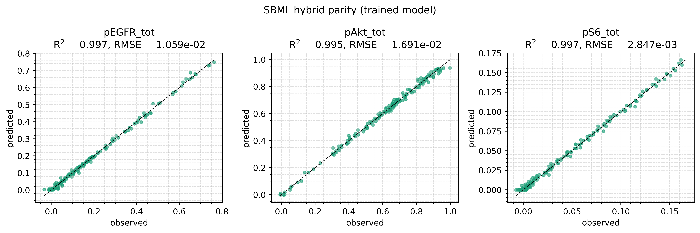
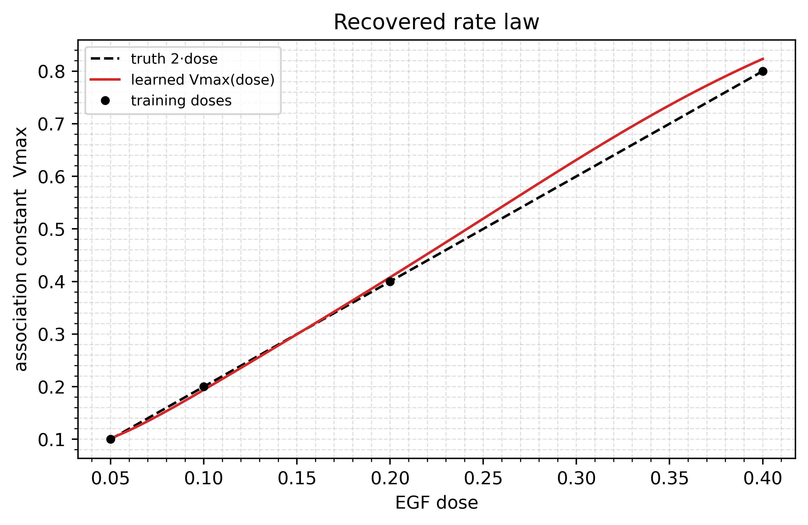

# SBML hybrid kinetics

Loads a published SBML model, the EGF/ERK cascade of Fujita et al.
(*Sci. Signal.* 2010), and replaces one of its rate constants with a
network. Read it if your mechanism already exists as an SBML file and only
one rate law is in doubt.

## Run it

```bash
uv sync --extra examples   # python-libsbml and sympy
uv run python examples/sbml_hybrid/train_sbml_hybrid.py
```

About a minute on CPU. Prints the buckets, per-channel metrics and the
learned `Vmax` at each dose; writes `parity.png` and `recovered_vmax.png`
to `examples/sbml_hybrid/figures/`. `--steps 5 --no-plot` is a quick
smoke run.

## The model

The SBML file has 9 species and 11 reactions. `sbml_loader.py`, a short
converter next to the script, reads each kinetic law as MathML with
python-libsbml, turns it into a sympy expression and lambdifies it to JAX.
It also reads species, parameters, stoichiometry, initial assignments and
the state-dependent assignment rules. Those rules are the paper's scaled
readouts `pEGFR_tot`, `pAkt_tot` and `pS6_tot`, and they serve as
`state_to_output`.

Reaction `v1`, EGF binding to its receptor, is reversible mass action:

```
v1 = Cell * (EGF * EGFR * k1 - EGF_EGFR * k2)
```

The forward constant `k1` becomes `Vmax(dose)`, a `BoundedPredictor` of
the EGF dose. The reverse constant `k2` stays as published. The data are
simulated with `Vmax(dose) = 2 * dose` at four doses with 2% noise on each
readout, and the fit has to recover that law.

Two numerical choices matter:

- **Keep the reverse term.** An irreversible uptake law drives EGFR to
  exactly zero, and the solver stalls on the kink, taking over 50k steps
  at some parameter values. The reversible law has a smooth equilibrium.
- **Use Kvaerno3.** Kvaerno5's Newton solve diverges at isolated parameter
  values (`Vmax = 0.5445` fails, `0.54450196` succeeds). Kvaerno3
  integrates the whole range in 50 to 100 steps.

## Code

`replace_flux` swaps `k1` for a symbol named `Vmax`, and `simulate_fn`
fills it from the network before integrating the SBML vector field:

```python
sbml.replace_flux(
    "v1_reaction_1",
    expr=sp.Symbol("Cell")
    * (sp.Symbol("Vmax") * egf * egfr - sp.Symbol("reaction_1_k2") * egf_egfr),
    extra_params=("Vmax",),
)


def simulate_fn(predictors, ts, covariates, y0, solver):
    dose = covariates["dose"]
    # The dose is constant per experiment, so Vmax is evaluated once per solve.
    vmax = predictors["Vmax"]({"dose": dose})[0]
    params = {**sbml.params, "EGF": dose, "Vmax": vmax}
    return sbml.integrate(solver, ts, y0, params)
```

The network and the fit:

```python
vmax = hm.BoundedPredictor(
    inner=hm.MLPPredictor(
        in_size=1, out_size=1, width_size=16, depth=2, activation_name="tanh", key=k_model
    ),
    input_keys=("dose",),
    input_bounds=(0.03, 0.5),
    output_bounds=(0.05, 1.0),
)
model = hm.HybridModel(
    predictors={"Vmax": vmax},
    simulate_fn=simulate_fn,
    state_to_output=state_to_output,
    output_channel_names=CHANNELS,
    solver=SOLVER,
)
# A small bound penalty keeps the output squash away from saturation.
config = hm.OptaxTrainingConfig(steps=args.steps, lr=1e-2, penalty_weight=1e-2)
```

## Results

Seed 0, 120 steps. All three readouts fit with `R^2 >= 0.995`, and the
learned `Vmax` is within 5% of `2 * dose` at every training dose.





## Things to try

- Replace a different flux with `replace_flux`, for example a
  Michaelis-Menten step further down the cascade.
- Set `penalty_weight=0` and watch whether the output squash saturates.
- Drop `0.2` from `DOSES` and check how well the learned `Vmax`
  interpolates across the gap.
