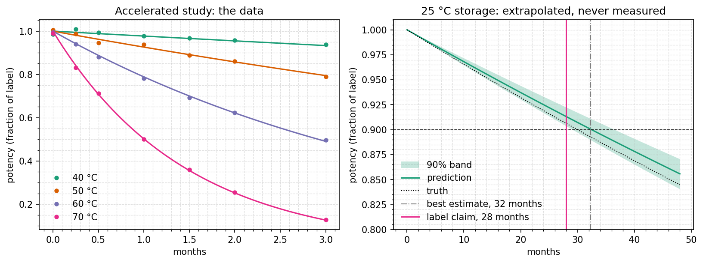

# Shelf life

How long does a drug keep its potency? At the storage temperature it degrades
too slowly to measure in a few months, so an accelerated study stores it hot,
measures for three months, and extrapolates the rate down to 25 °C. The answer
that goes on the label is not the best estimate. It is the one-sided 95% lower
bound on the shelf life, so this example's result is a statement about
uncertainty, and the uncertainty decides it.

It needs no sampler: the maximum likelihood, the Fisher information and a
profile likelihood are enough. Read the
[uncertainty guide](/guide/uncertainty#without-sampling) for the methods
themselves.

## Run it

```bash
uv run python examples/shelf_life/shelf_life.py
uv run python examples/shelf_life/shelf_life.py --no-plot
```

About 20 seconds on CPU. Prints the fit, the rate's uncertainty at each
temperature and the shelf life, and writes `shelf_life.png` to
`examples/shelf_life/figures/`.

## The model

Potency $y$, as a fraction of the label claim, falls by first-order kinetics
whose rate follows Arrhenius:

$$
\frac{dy}{dt} = -k(T)\, y, \qquad
\log k(T) = \log k_{25} - \frac{E_a}{R}\left(\frac{1}{T} - \frac{1}{T_{25}}\right)
$$

The study stores the drug at 40, 50, 60 and 70 °C and assays it 7 times over
three months, with a 1% assay standard deviation. The data are drawn from a
known truth: 90% potency after 30 months at 25 °C, and $E_a$ of 100 kJ/mol.

The law is written around 25 °C, so $\log k_{25}$ is the parameter the label
needs, and its interval is the shelf life's interval. Written as
$A \exp(-E_a / RT)$ instead, the same information would be spread over two
parameters correlated at 0.999; the
[identifiability example](/guide/uncertainty#without-sampling) shows that case.

<<< @/../examples/shelf_life/shelf_life.py#model

## The fit and its information

The trainer gets close, and `optimize` finishes at the maximum likelihood.
`noise="data"` uses the assay variance given with each measurement, and
`log_prior=None` keeps this a likelihood-only problem:

<<< @/../examples/shelf_life/shelf_life.py#fisher

```text
Fisher information
                estimate    std error  95% interval
  Ea_over_R    1.217e+04        173.6  [1.183e+04, 1.251e+04]
  log_k25         -5.726      0.06914  [-5.862, -5.591]
  Strongest correlations
    Ea_over_R and log_k25: -0.989
  Condition number 178
```

## Extrapolating

The rate at any temperature is a line in $1/T$ through the data, and a line is
known best near the middle of its data and worst far beyond it. `derived` gives
the standard error of any function of the values by the delta method, using
their covariance, correlation included. Here it is applied to $\log k$ at each
temperature:

<<< @/../examples/shelf_life/shelf_life.py#extrapolation

```text
Relative uncertainty of the rate, one standard error:
    25 °C  ±6.9%  (storage, no data)
    40 °C  ±4.2%
    50 °C  ±2.6%
    60 °C  ±1.3%
    70 °C  ±1.3%
```

At 25 °C, where nothing was measured, the rate is five times less certain than
at 60 or 70 °C. That uncertainty passes straight into the shelf life, which is
inversely proportional to $k_{25}$.

## The shelf life

A two-sided 90% interval has a one-sided 95% bound at each end. The fastest
plausible rate gives the shortest plausible shelf life, and the claim is that
bound rounded down to whole months. The profile likelihood gives the bound
without assuming the estimate is Gaussian:

<<< @/../examples/shelf_life/shelf_life.py#shelf-life

```text
Shelf life at 25 °C: 32.3 months, best estimate
  one-sided 95% lower bound 28.9 months, so a label claim of 28 months
```

The true shelf life is 30.0 months. A label set from the best estimate would
have claimed 32, and the product would have been out of specification for its
last two months. The lower bound claims 28.

The delta method gives a bound on any function of the values, with no need to
reparametrise. `interval(side="lower")` makes it one-sided:

<<< @/../examples/shelf_life/shelf_life.py#delta-method

```text
  delta method: 32.3 ± 2.2 months,
  one-sided 95% lower bound 28.6 months
```

It is 0.3 months lower than the profile's bound, because it treats the shelf
life, which is $1/k_{25}$, as Gaussian, while the profile assumes nothing about
its shape. When the two disagree by much, trust the profile.

### At another storage temperature

To claim a shelf life at 30 °C, profile the rate at 30 °C. Write the law around
that temperature, so that its rate is a parameter:

```python
def rate(log_k30, ea_over_r, temperature_c):
    return jnp.exp(log_k30 - ea_over_r * (1 / (273.15 + temperature_c) - 1 / 303.15))
```

The data and the fit are unchanged, since this is the same law with different
parameters. Then use `mle.profile("log_k30", confidence=0.90)` as above.
For a quick check without refitting, use `derived` on the existing fit with
`rate(values["log_k25"], values["Ea_over_R"], 30.0)`.

Draws from the estimate's sampling distribution carry its uncertainty into any
function of it. `FisherResult.sample` gives them, and `predict` turns them into a
potency band at 25 °C, a condition the study never ran:

<<< @/../examples/shelf_life/shelf_life.py#band

The draws' 5th percentile of the shelf life is 28.9 months, the same as the
profile's bound, because this likelihood is close to Gaussian in $\log k_{25}$.



## What the interval does not cover

The interval assumes the model. If the degradation is not first order, or
Arrhenius does not hold from 70 °C down to 25 °C, for instance because the
mechanism changes, the interval says nothing about it. This is why real labels
rest on long-term data at the storage condition, evaluated with the same kind
of lower bound (ICH Q1E), and why accelerated studies like this one are used to
predict them early.

The band is for the mean potency curve. A single assay scatters around it by
the assay's 1%.
