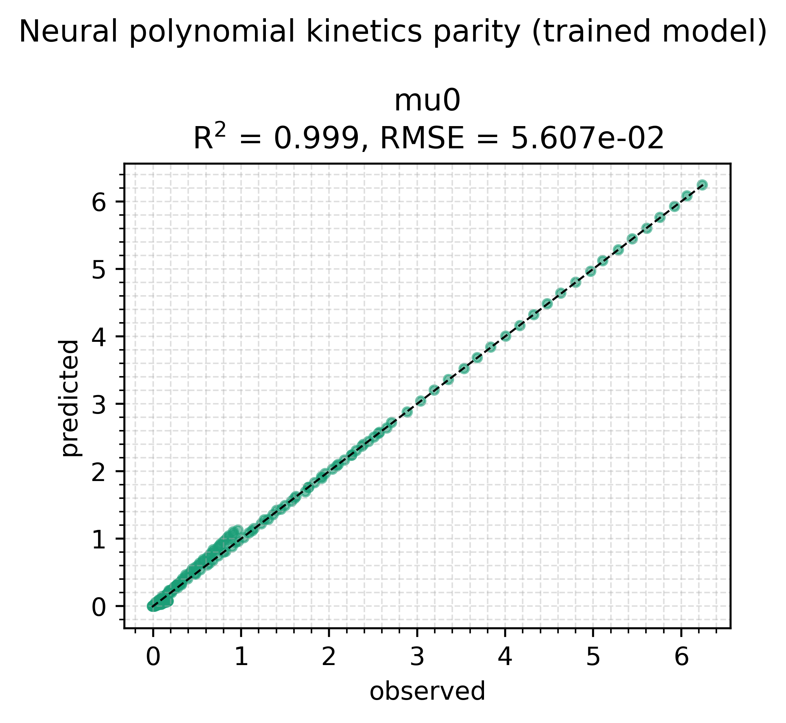
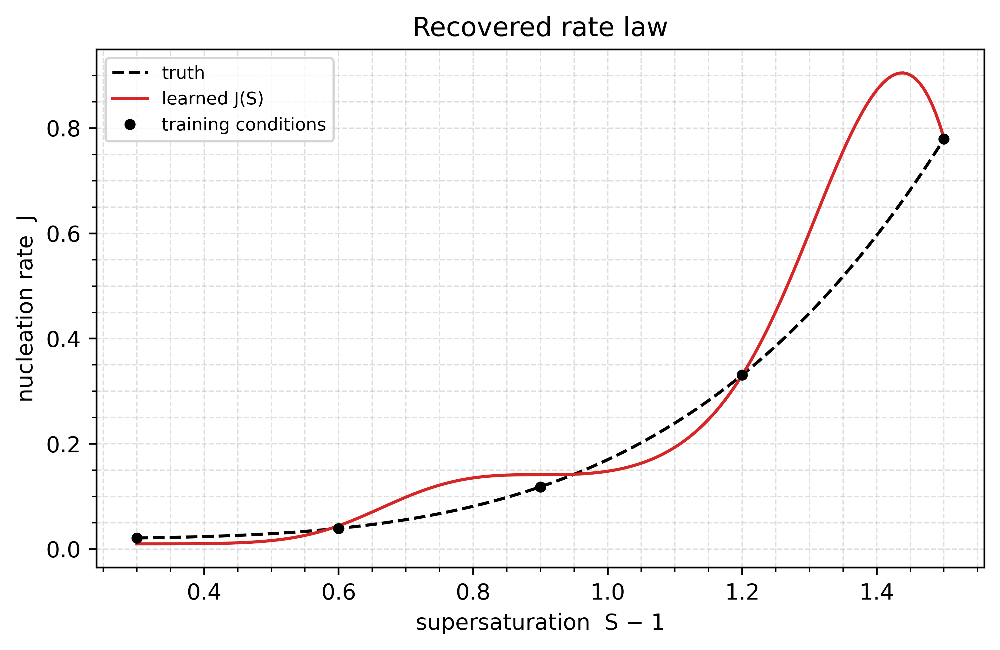

# Neural polynomial kinetics

`NeuralNPolynomial` writes each output as a polynomial whose coefficients
come from an inner network. For nucleation kinetics that is a power-law
prior in supersaturation `S - 1`, in place of a black-box MLP.

The model tracks two moments of the crystal size distribution:

```
d mu0/dt = J          (nucleation)
d mu1/dt = G * mu0    (growth)
```

Growth `G` is known. The nucleation rate `J(S)` is a polynomial with
exponents 2, 3 and 4 whose coefficients come from a small MLP, wrapped in a
`BoundedPredictor` so it stays inside `(0.01, 2.0)`. Only `mu0` is
measured. The data is synthetic, `J_true = 0.02 + 0.15 (S - 1)^4` plus
noise, at five supersaturations.

```bash
uv run python examples/supersaturation_poly/train_supersaturation_poly.py
```

## The polynomial basis is latent

`NeuralNPolynomial` evaluates its polynomial at `sum(x)`, where `x` is the
input after the `BoundedPredictor`'s input scaler. The basis is therefore a
latent coordinate of `S - 1`, not `S - 1` itself. If you want a polynomial
in one variable with coefficients conditioned on another, for example
`sum_i c_i(T) * (S - 1)^p_i`, compose two predictors in the vector field.

## The script

<<< ../../examples/supersaturation_poly/train_supersaturation_poly.py

## Results

Seed 0, 400 steps. The `mu0` series fit to the noise floor
(`R^2 = 0.998`).





The learned rate matches the truth at the five training supersaturations
and wanders between them, because the data says nothing about `J` there.
More conditions, or fewer free coefficients, would tighten the curve.
