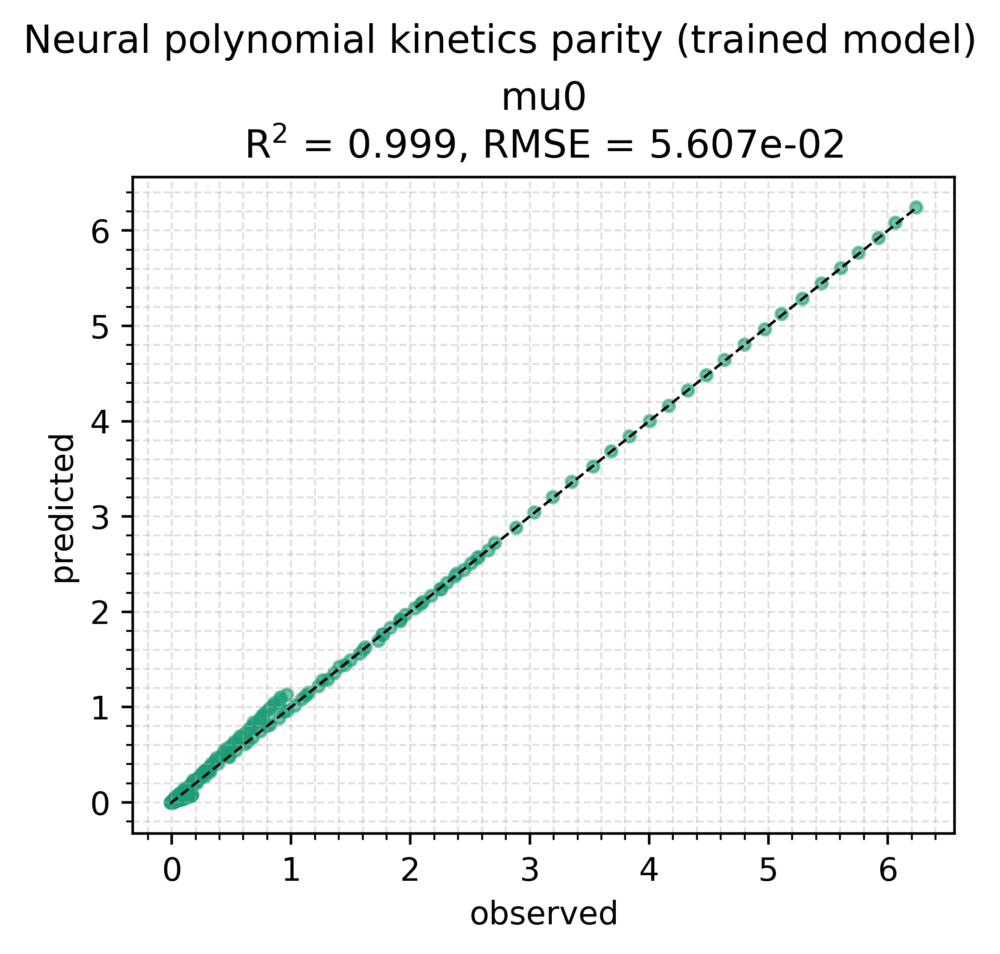
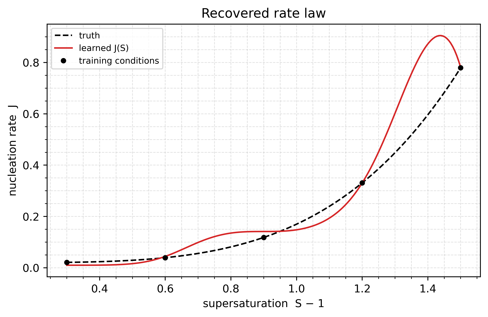

# Neural polynomial kinetics

Learns a nucleation rate with `NeuralNPolynomial`, which writes each output
as a polynomial whose coefficients come from an inner network. Read it when
you expect a power law and want that prior in place of a black-box MLP.

## Run it

```bash
uv run python examples/supersaturation_poly/train_supersaturation_poly.py
```

About 10 s on CPU. Prints the buckets, metrics and the learned rate at
each supersaturation; writes `parity.png` and `recovered_rate.png` to
`examples/supersaturation_poly/figures/`. `--steps 5 --no-plot` is a quick
smoke run.

## The model

Two moments of the crystal size distribution:

```
d mu0/dt = J          (nucleation)
d mu1/dt = G * mu0    (growth)
```

Growth `G` is known. The nucleation rate `J(S)` is a polynomial with
exponents 2, 3 and 4 whose coefficients come from a small MLP, wrapped in a
`BoundedPredictor` so it stays inside `(0.01, 2.0)`. Only `mu0` is
measured. The data is synthetic, `J_true = 0.02 + 0.15 (S - 1)^4` plus
noise, at five supersaturations.

The polynomial basis is latent. `NeuralNPolynomial` evaluates its
polynomial at `sum(x)`, where `x` is the input after the
`BoundedPredictor`'s input scaler, so the basis is a latent coordinate of
`S - 1`, not `S - 1` itself. For a polynomial in one variable with
coefficients conditioned on another, for example
`sum_i c_i(T) * (S - 1)^p_i`, compose two predictors in the vector field.

## Code

`J` depends only on the constant supersaturation, so `simulate_fn`
evaluates it once and integrates at that rate:

<<< @/../examples/supersaturation_poly/train_supersaturation_poly.py#simulate-fn

The predictor:

<<< @/../examples/supersaturation_poly/train_supersaturation_poly.py#predictor

## Results

Seed 0, 400 steps. The `mu0` series fit with `R^2 = 0.998`, but the MSE of
about 3e-3 is some 30 times the noise variance of 1e-4, and the loss was still
falling when the step budget ran out.





The learned rate matches the truth at high supersaturation (within 0.5% at
`S - 1` of 1.2 and 1.5) and misses at low supersaturation: 0.0100 against
0.0212 at 0.3, and 13 to 19% off at 0.6 and 0.9. The data do constrain the
low rate: with `dmu0/dt = J`, an error of 0.011 in `J` puts the moment 0.09
off by `t = 8`, about 9 noise standard deviations. The value 0.0100 is the
lower edge of the output box, `J_BOUNDS = (0.01, 2.0)`. The rate there is
pinned in the squash's tail, where its gradient vanishes, so training cannot
pull it back up to the truth. A lower edge well below the smallest expected
rate, a bound penalty (see [Penalties](/guide/penalties)), or more steps would
free it.

## Things to try

- Change `EXPONENTS` to `(4.0,)`, the true power, and compare the curve
  between training points.
- Swap the polynomial for a plain `MLPPredictor` with the same bounds.
- Add supersaturations to `SUPERSATURATIONS` and watch the gaps close.
