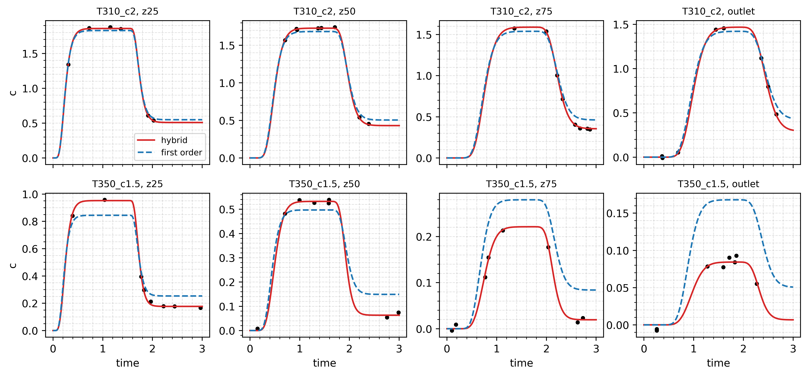
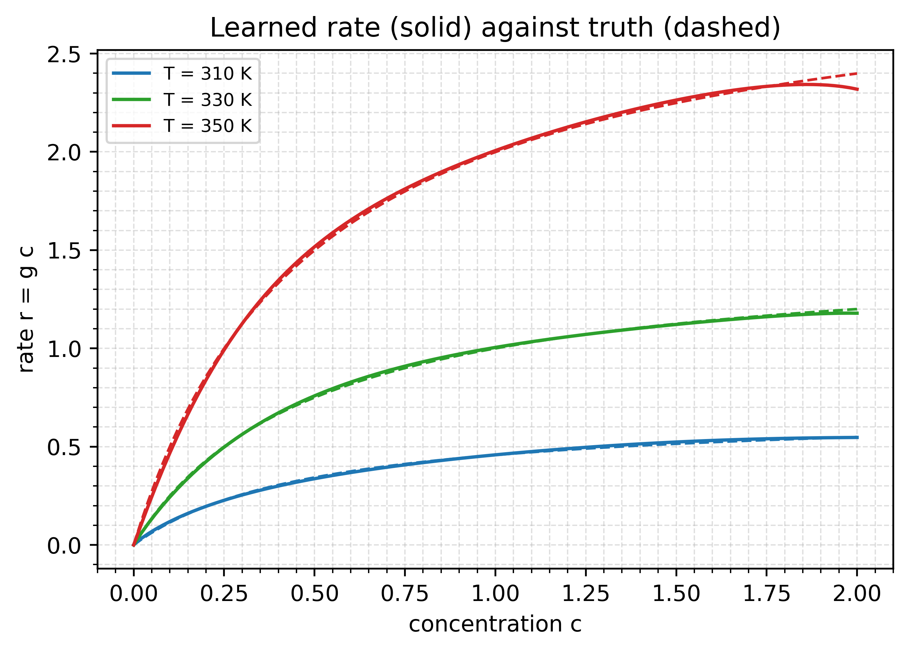
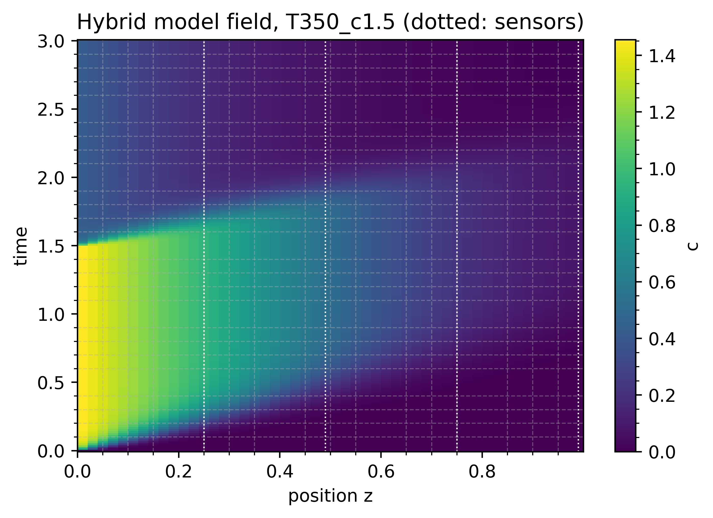

# Tubular reactor

A reaction rate learned inside a partial differential equation. The tube is
discretised into 50 cells, so the model state has 50 entries, but only four
sensors are measured. The example shows that a PDE needs nothing special
from the library: the method of lines turns it into an ODE, `simulate_fn`
returns the whole field, and `state_to_output` picks the sensor cells.

Read it after the [hybrid ODE](/examples/hybrid-ode) example, which covers
networks inside the vector field on a small state.

## Run it

```bash
uv run python examples/tubular_reactor/train_tubular_reactor.py
uv run python examples/tubular_reactor/train_tubular_reactor.py --steps 5 --no-plot  # smoke test
```

About two minutes on CPU at the default 600 steps per model. Prints both
fits' metrics and the learned rate against the truth, and writes
`sensors.png`, `rate_law.png` and `field.png` to
`examples/tubular_reactor/figures/`.

## The model

Liquid flows through a tube of length $L = 1$ at speed $u = 1$, with axial
dispersion $D = 0.01$, and a reactant is consumed as it goes:

$$
\frac{\partial c}{\partial t} = -u \frac{\partial c}{\partial z} + D \frac{\partial^2 c}{\partial z^2} - r(c, T)
$$

The inlet concentration is held at the feed value, which drops to 30% at
$t = 1.5$; the outlet has zero gradient. Advection uses first-order upwind
differences and dispersion central differences. Each of the six
experiments has its own temperature $T$ and feed concentration, both
covariates.

Transport is known. The rate law is not. The data come from
Langmuir-Hinshelwood kinetics,

$$
r = \frac{k(T)\, c}{1 + K c}, \qquad k(T) = k_\text{ref} \exp\!\left(-\frac{E_a}{R}\left(\frac{1}{T} - \frac{1}{T_\text{ref}}\right)\right),
$$

with $E_a/R = 4000$ K and $K = 2$. The hybrid model writes $r = g(c, T)\,c$
and learns $g$ with a bounded network. Factoring out $c$ means the learned
rate is zero at zero concentration and never negative, whatever the
network does, so the network cannot invent reactant.

The comparison model assumes first-order Arrhenius kinetics,
$r = k(T)\,c$, with $k_\text{ref}$ and $E_a/R$ as `Parameter`s.

Each sensor samples eight random times per experiment, so the four
channels never share a time grid and the dataset is 76% masked.

## Code

The discretised transport operator and the solve. `step_profile` builds the
inlet concentration from the experiment's covariates:

<<< @/../examples/tubular_reactor/train_tubular_reactor.py#pde

The hybrid evaluates the network once per cell with `jax.vmap`, and the
observation map indexes the sensor cells:

<<< @/../examples/tubular_reactor/train_tubular_reactor.py#simulate

The two models share sensors and solver, so the first-order model is the
hybrid with its predictors and simulator swapped:

<<< @/../examples/tubular_reactor/train_tubular_reactor.py#models

Both train with the same two phases. The first sees only the first half of
each experiment, the start-up front, before the feed drop:

<<< @/../examples/tubular_reactor/train_tubular_reactor.py#fit

### Solver and adjoint

The stiffest mode of the discretised operator is dispersion, at about
$4D/\Delta z^2 = 100$ per unit time. That is mild, so explicit `Tsit5`
takes a few hundred steps per solve. Halving $\Delta z$ quadruples that
rate; past roughly 200 cells an implicit solver such as `Kvaerno3` takes
fewer steps.

The config sets `adjoint=diffrax.RecursiveCheckpointAdjoint()`. The
backward pass goes through the network at every cell and every solver
step. The library's default, `DirectAdjoint`, stores that whole tape and
compiles in time that grows with `max_steps`. Recursive checkpointing
stores $O(\log n)$ checkpoints and recomputes the rest. See
`ADJOINT_REGISTRY` in `jaxhybridmodels.solver` for the other choices.

## Results

Default settings, seed 0. Sensor noise has standard deviation 0.01.

| model | RMSE z25 | RMSE z50 | RMSE z75 | RMSE outlet | worst $R^2$ |
|---|---|---|---|---|---|
| hybrid, learned $g(c, T)$ | 0.011 | 0.010 | 0.009 | 0.011 | 0.999 |
| first order, fitted Arrhenius | 0.078 | 0.075 | 0.089 | 0.080 | 0.952 |

The hybrid fits to the noise level. The first-order model misses by about
eight times the noise, and its $R^2$ drops at the two downstream sensors,
where a wrong rate has acted for longer.



The first-order model also gets its constants wrong. It fits
$E_a/R = 5139$ K against a true 4000 K. The true effective coefficient is
$k(T)/(1 + Kc)$. Cold runs convert little, so $c$ stays high and the
coefficient is suppressed by the denominator; hot runs consume the
reactant, so $c$ is low and the coefficient is close to $k(T)$. Seen
through a first-order model, the rate rises with temperature faster than
Arrhenius alone, and the fit reads that as a larger activation energy.

The learned rate law matches the truth across the measured box:

| $c$ | $T$ (K) | true $r$ | learned $r$ |
|---|---|---|---|
| 0.2 | 310 | 0.196 | 0.196 |
| 1.5 | 310 | 0.515 | 0.524 |
| 0.2 | 350 | 0.857 | 0.840 |
| 1.5 | 350 | 2.249 | 2.264 |



At 350 K the learned curve bends away from the truth above $c \approx 1.8$.
No hot experiment reaches that concentration, since the hottest feed is
1.5 and the reaction is fast. The network has no data there.

The full field of the hottest run shows what the sensors sample: the
start-up front, the feed drop at $t = 1.5$, and conversion along the tube.



## Things to try

- Change `N_CELLS` to 200 and time a run with `diffrax.Tsit5()` against
  `diffrax.Kvaerno3()`.
- Keep only the outlet in `SENSORS` and compare the recovered rate law.
  One channel sees the integrated effect of the whole tube.
- Replace `RecursiveCheckpointAdjoint` with `diffrax.DirectAdjoint()` and
  compare compile time and memory.
- Add a hot experiment with feed 2.0 to `CONDITIONS` and check that the
  learned curve at 350 K follows the truth to $c = 2$.
